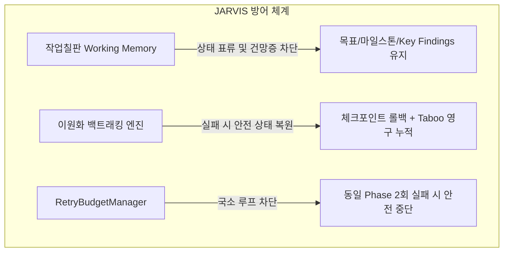
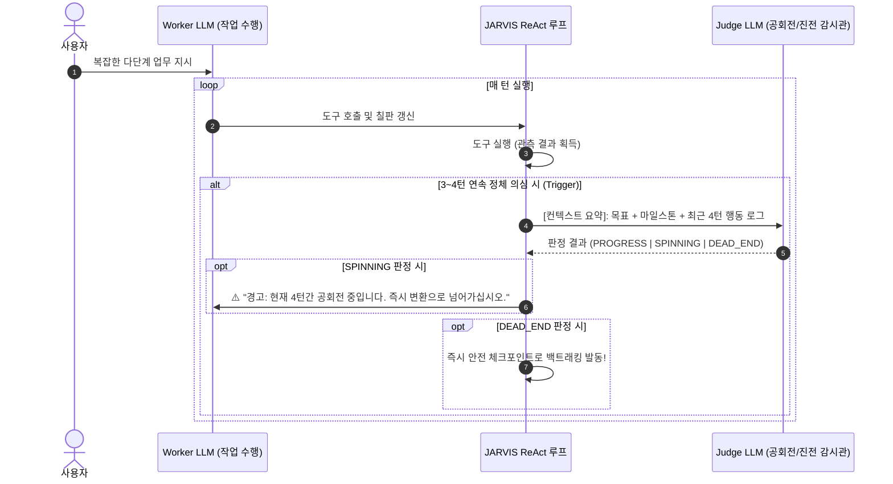

# JARVIS 에이전트 턴 제어 및 종료 정책 아키텍처 설계서
(Agent Turn Management, Backtracking & Termination Policy Architecture)

> **문서 버전**: v1.1  
> **최종 수정일**: 2026-09-21  
> **상태**: 설계 및 검토 완료 (Approved Design)  
> **관련 모듈**: `src/jarvis/brain/agent.py`, `src/jarvis/brain/evaluator.py`, `src/jarvis/brain/checkpoint.py`, `src/jarvis/brain/memory.py`, `src/jarvis/tools/system.py`

---

## 1. 배경 및 문제 제기 (Context & Problem Statement)

### 1.1 기존 고정 턴수(`max_turns`)의 구조적 한계
JARVIS의 ReAct 실행 루프는 기본적으로 `max_turns` (예: 15턴)의 정적 상한선을 가지고 있었습니다.  
그러나 실제 엔터프라이즈 업무 자동화(예: 다채널 주문서 10개 처리, 수십 페이지 웹 스크래핑 등)를 수행하면서 다음과 같은 치명적인 한계가 드러났습니다:

1. **정상 대형 작업의 강제 중단 (False Negative / 오탐)**
   * 에이전트가 단 한 번의 실수도 없이 완벽하게 파일들을 순차적으로 읽고, 취합하고, 변환하는 중임에도 단순히 '15턴'에 도달했다는 이유로 작업을 강제 종료당함.
2. **정적 제어와 동적 현실의 불일치**
   * 작업의 복잡도와 처리 대상 데이터의 양은 동적인데, 이를 정적인 턴 상한선으로 통제하려는 구조적 모순 발생.

### 1.2 핵심 설계 질문 (Core Design Question)
> **"우리는 작업칠판(Blackboard)을 도입했고, 예외/막다른 길에 대응하는 백트래킹(Taboo List)이 존재하므로 전체 턴수를 제한할 필요가 없는 것이 아닌가? 동일한 단계를 실패했을 때만 턴수를 제한하면 충분하지 않은가?"**

이 질문을 검증하기 위해 현재 JARVIS의 방어력과 실제 실행 시 발생할 수 있는 엣지 케이스를 종합적으로 분석하였습니다.

---

## 2. 현재 JARVIS 시스템 아키텍처 및 고유 방어력 분석

JARVIS는 단순 순차 ReAct 에이전트와 달리, 이미 강력한 **3중 상태 보존 및 실패 제어 기제**를 갖추고 있습니다.



### 2.1 작업칠판(Blackboard)의 상태 유지력
* `WorkingMemory`는 현재 단계(`current_phase`), 마일스톤(`milestones`), 발견 사실(`key_findings`), 금기 사항(`taboo_list`)을 구조화하여 매 턴 시스템 프롬프트에 주입합니다.
* 턴이 길어져도 **"내가 지금 무엇을 하고 있는가"에 대한 컨텍스트 표류(Drift)나 기억 상실(Amnesia)을 원천 차단**합니다.

### 2.2 이원화된 백트래킹 엔진 (Dual-Track Backtracking Engine)
현재 코드베이스([agent.py](file:///c:/Coding/jarvis/src/jarvis/brain/agent.py#L160-L285))에서 백트래킹은 **시스템 자동 감지**와 **LLM 자율 호출**의 이원화 구조로 동작합니다:

```mermaid
graph TD
    A[에이전트 ReAct 루프] --> B{실행 결과 평가}
    
    %% 경로 1
    B -->|도구 실행 중 예외/에러/0바이트 발생| C[1. 시스템 주도 자동 롤백<br/>Implicit System Backtracking]
    C --> E[UniversalRuleEvaluator 감지<br/>passed = False]
    
    %% 경로 2
    B -->|도구 에러는 없으나 데이터 오류 인지| D[2. LLM 주도 자율 롤백<br/>Explicit backtrack 도구 호출]
    D --> F[agent.py에서<br/>tc.name == 'backtrack' 감지]
    
    E --> G[공통 롤백 파이프라인]
    F --> G
    
    subgraph 공통 롤백 처리 (checkpoint.py & agent.py)
        G --> H[1. ShadowWorkspace staging.discard 즉시 폐기]
        G --> I[2. checkpoint.rollback_to 직전 안전 상태 복원]
        G --> J[3. failure_reason을 accumulated_taboo에 영구 누적]
        G --> K[4. 실패한 대화 기록 Pruning 가지치기]
        G --> L[5. 단계별 실패 예산 branch_failures +1]
    end
```

1. **경로 1: 시스템 주도 자동 백트래킹 (System-driven Implicit Backtracking)**
   * **발동 조건**: 도구 실행 중 Python 예외(`Exception`), `"Error: ..."` 반환, 0바이트 빈 파일 생성, 동일 인자 연속 호출(루프) 등.
   * **동작**: `UniversalRuleEvaluator`가 즉각 `passed = False`로 판정하며, **LLM의 개입 없이 시스템 차원에서 즉시 가상 작업영역(Staging)을 폐기하고 직전 체크포인트로 롤백**합니다.
2. **경로 2: LLM 주도 자율 `backtrack` 도구 (LLM-driven Explicit Backtracking)**
   * **발동 조건**: 도구 자체는 오류 없이 실행되었으나(예: 파일은 열렸으나 주문 데이터가 아니라 공지사항인 경우), LLM이 논리적인 막다른 길(Dead-end)을 인지했을 때.
   * **동작**: LLM이 직접 **`backtrack(reason="...")`** 도구를 호출하여 능동적으로 직전 단계 복귀를 요청합니다.
3. **Taboo List의 영구 누적 (`checkpoint.py`)**:
   * 어떤 경로로 롤백되든 실패 사유는 `accumulated_taboo`에 영구 기록되어 작업칠판의 `⚠️ [TABOO LIST & LESSONS LEARNED]`로 주입되므로, **이전에 실패했던 방식을 재반복하는 일은 구조적으로 불가능**합니다.

### 2.3 기존 동일 단계 실패 한도의 구조적 맹점: "조기 항복(Premature Surrender)"
* 현재 코드베이스의 `RetryBudgetManager`는 특정 Phase에서 연속 2회(`max_retries_per_branch=2`) 실패 시 작업을 즉시 강제 중단하도록 구현되어 있습니다.
* **치명적 문제점**:
  1. **유효한 대안 도구의 박탈**: 사용 가능한 도구가 3~4가지(예: `batch_transform_orders`, `transform_excel`, `run_python` 등) 존재하더라도, 앞선 2개 도구가 실패하면 3번째 유력한 도구는 써보지도 못하고 강제 종료됨.
  2. **매개변수 튜닝 기회의 박탈**: 엑셀 헤더 위치(0행 vs 1행)나 인코딩(`utf-8` vs `cp949`) 등 파라미터를 다르게 주어 3번째에 충분히 성공할 수 있는 문제인데도 2회 만에 시스템이 에이전트의 손발을 묶어버림.
* ➔ **결과**: "조금만 탐색하면 해결할 수 있는 정상 작업"을 시스템의 경직된 카운터로 인해 실패로 단정하는 **심각한 조기 항복(Premature Surrender)**이 발생합니다.

---

## 3. 핵심 쟁점과 사각지대 분석 (The Core Dilemma)

"동일 단계 실패 한도 + Taboo 누적"으로 단순 루프는 통제할 수 있지만, 실제 현장에서는 다음 **3대 상반된 쟁점**이 충돌합니다.

### 3.1 쟁점 1: '진전 없는 성공'의 공회전 (Spinning Wheels)
도구 실행이 **성공(PASS)**하면 예외가 없으므로 `branch_failure`가 올라가지 않고 `taboo_list`에도 들어가지 않습니다:

```text
[Turn 1] scan_directory(path="orders")        ──> 성공 (파일 2개 발견, PASS)
[Turn 2] read_excel(file="orders/naver.xlsx")  ──> 성공 (10행 정상 반환, PASS)
[Turn 3] read_excel(file="orders/coupang.xlsx")──> 성공 (15행 정상 반환, PASS)
── [여기서 바로 변환 도구를 실행해야 하나, LLM이 분석 마비에 빠짐] ──
[Turn 4] inspect_excel(file="orders/naver.xlsx")──> 성공 (시트 정보 재확인, PASS)
[Turn 5] find_in_file(path="orders/naver.xlsx") ──> 성공 (헤더 재검색, PASS)
[Turn 6] inspect_excel(file="orders/coupang.xlsx")──> 성공 (PASS)
...
[Turn 30] scan_directory(path="orders")        ──> 성공 (PASS)
```

#### 공회전의 3대 발생 원인
1. **분석 마비 (Analysis Paralysis)**: "혹시 누락된 컬럼이 없을까?" 불안해하며 이미 읽었던 파일을 다른 도구/인자로 반복 재조회.
2. **도구 선택 주저 (Indecision)**: 일괄 변환을 쓸지 개별 변환을 쓸지 결정을 못 내리고 조회 도구만 호출.
3. **읽기(Observation) 도구의 무비용 성공**: 읽기 도구는 실패 확률이 거의 없으므로 Evaluator를 손쉽게 통과하여 시스템 실패 카운터를 무력화함.

---

### 3.2 쟁점 2: 실제로 여러 작업이 필요한 정당한 다작업 (Legitimate Multi-tasking)

> **"그런데 공회전이 아니라 실제로 파일이 10~20개라서 하나씩 다 읽고 검증해야 하는 경우라면?"**

만약 시스템이 "연속 N턴 동안 마일스톤이 완료되지 않았다"는 이유만으로 작업을 끊어버린다면, **열심히 일하고 있는 에이전트를 강제로 차단하는 치명적인 오탐(False Positive)**이 발생합니다.

#### 공회전 vs 정당한 다작업의 결정적 차이: "상태의 순증가(Net Progress Signal)"

| 비교 항목 | 🚨 겉도는 공회전 (Spinning Wheels) | 🚀 정당한 다작업 (Legitimate Multi-tasking) |
| :--- | :--- | :--- |
| **도구 대상 (Target/Arg)** | **동일하거나 유사한 대상 반복 조회**<br/>(`order_A.xlsx` 시트 검사 ➔ 헤더 검색 ➔ 재조회...) | **매 턴 고유한 새로운 대상을 처리**<br/>(`01_naver.xlsx` ➔ `02_coupang.xlsx` ➔ `03_11st.xlsx`...) |
| **작업칠판 `key_findings`** | 새로운 발견 없이 요약 문장만 제자리걸음 | **새로운 데이터 및 파일 분석 결과가 턴마다 차곡차곡 누적됨** (엔트리 지속 증가) |
| **처리율 (Progress)** | 0%에서 멈춤 | **[1/10] ➔ [2/10] ➔ [3/10] 점진적 상승** |
| **시스템 조치** | **조기 개입 및 강제 중단 필요** | **턴수를 보너스로 연장하며 끝까지 완주 보장** |

---

### 3.3 쟁점 3: 백트래킹과 포기의 주도권 — "시스템 카운터 vs AI 자율 판단"

> **"여기서는 AI가 알아서 백트래킹 도구를 호출하는 게 맞지 않는가? 2번이라는 너무 적고 제한된 기회를 시스템이 일방적으로 부여하는 것은 문제가 있다."**

"현재 시점에서 어떤 대안 도구가 남아있는지", "파라미터를 어떻게 바꾸어 재시도할 여지가 있는지"를 가장 잘 파악하는 주체는 **도구 스키마와 프롬프트를 실시간으로 바라보는 AI(LLM) 자신**입니다:

1. **AI의 대안 공간 인지력 존중**:
   * AI는 `taboo_list`를 보며 *"A 도구는 실패했으니 B 도구를 쓰거나, 인코딩을 바꿔 시도해보자"*라는 유연한 복원력을 발휘할 수 있습니다.
2. **자율적 막다른 길(Dead-End) 선언**:
   * 도구와 파라미터 대안을 모두 탐색했음에도 해결 불가능하다고 판단되면, **AI 스스로 `backtrack(reason="시도할 수 있는 도구 및 파라미터 대안 소진")` 도구를 호출하거나 포기를 선언**하는 것이 훨씬 지능적입니다.
3. **시스템의 역할 재정의**:
   * 시스템은 AI의 목을 자르는 '집행관(Executioner)'이 아니라, AI가 환각으로 10번 이상 끝없이 같은 자리를 파는 최악의 폭주만 막아주는 **'소프트 가드레일(Soft Guardrail, 예: 5~6회)'**이어야 합니다.

---

## 4. 종합 해결책: 계층형 스마트 턴 거버넌스 (Proposed Architecture)

공회전은 조기에 차단하고, 정당한 대형 작업은 턴수 제약 없이 완주시키기 위해 다음 **4계층 거버넌스 체계**를 제안합니다.

```mermaid
flowchart TD
    Start([에이전트 시작]) --> Loop[ReAct 턴 실행]
    
    %% 계층 1
    Loop --> L1{1. 도구 실행 결과?}
    L1 -- 실패/에러/backtrack --> L1_Fail[branch_failures +1]
    L1_Fail --> L1_Check{동일 Phase 소프트 가드레일<br/>초과 (예: 5~6회)?}
    L1_Check -- Yes --> AbortFail[작업 실패 안전 종료]
    L1_Check -- No --> Rollback[Staging 폐기 + 롤백 + Taboo 등록]
    Rollback --> L1_AI{AI 자율 판단:<br/>남은 대안 도구/파라미터 있는가?}
    L1_AI -- 대안 있음 --> Loop
    L1_AI -- 대안 전무 --> AbortSelf[AI 스스로 backtrack 호출 및 종료]
    
    %% 계층 2
    L1 -- 성공 PASS --> L2{2. 스마트 정체 감지<br/>Smart Stagnation Check}
    L2 -- 순증가 발생<br/>(새 대상 or 새 Key Finding) --> L2_Advance[정체 카운터 = 0<br/>+ 동적 보너스 턴 부여]
    L2 -- 순증가 없음<br/>(동일 대상 반복 & 칠판 정체) --> L2_Count[정체 카운터 +1]
    L2_Count --> L2_Stuck{정체 카운터 >= 5턴?}
    L2_Stuck -- Yes --> AbortStuck[공회전 감지 조기 차단]
    
    %% 계층 3
    L2_Advance --> L3{3. 전체 안전 상한선<br/>Global Circuit Breaker}
    L2_Stuck -- No --> L3
    L3 -- 100턴 도달 or 15분 초과 --> AbortTimeout[최후 안전선 강제 차단]
    L3 -- 정상 범위 --> Loop
```

---

### 해결책 1: 복합 스마트 정체 감지기 (Rule-based Smart Stagnation Detector)
단순히 "턴수가 흘렀는가"가 아니라, **3대 신호의 결합(AND 조건)**을 통해 공회전을 판별합니다:

```python
def is_stagnant(history_turns, current_memory) -> bool:
    """단순 턴수가 아닌 '실질적 전진 여부'를 복합 검증."""
    
    # 1. 최근 4턴 동안 도구 인자(Target Path, URL 등)에 새로운 대상이 전혀 없는가?
    recent_targets = [t.args.get('path') or t.args.get('url') or t.args.get('directory') for t in history_turns[-4:]]
    has_new_targets = len(set(filter(None, recent_targets))) > 1
    if has_new_targets:
        return False  # 새로운 대상을 계속 읽고 있다면 정당한 다작업 (정체 아님)
        
    # 2. 최근 4턴 동안 작업칠판의 key_findings에 새로운 지식이 누적되었는가?
    if current_memory.key_findings_growth_rate > 0:
        return False  # 새로운 데이터 분석 결과가 계속 기록 중이라면 정체 아님
        
    # 3. 마일스톤도 진전 없고, 대상도 동일하고, 발견도 제자리라면 -> 진짜 공회전!
    return True
```
* **동작**: `is_stagnant == True`가 4~5턴 연속 유지되면 LLM에게 *"5턴 동안 조사를 마쳤으니 즉시 변환 도구를 실행하십시오"* 경고를 주입하고, 지속 시 즉시 중단합니다.

> ⚖️ **트레이드오프 (Trade-off)**:
> * **장점 (Pros)**: **Zero Cost (추가 API 비용 0원)**, **0ms 즉각 판정**, 100% 결정론적(Deterministic) 동작으로 디버깅이 쉬움.
> * **단점/한계 (Cons)**: 규칙 기반(Heuristic)이므로, 도구 인자의 키 이름(`path`, `url`, `directory` 등)이 도구마다 제각각일 때 파싱 누락 위험. 비정형 웹 서핑처럼 "같은 URL이지만 쿼리 파라미터가 미세하게 바뀌는 경우" 오탐 또는 미탐 가능성 존재.

---

### 해결책 2: 진행도 기반 동적 턴 연장 (Progress-Aware Dynamic Turn Budget)
정상적으로 대형 작업을 수행하는 에이전트가 턴수 부족으로 잘리지 않도록 동적 충전 정책을 적용합니다.

* **기본 시작 턴수**: 15턴
* **턴 충전 트리거**:
  * 마일스톤(`milestones`)이 하나 완료(`DONE`)될 때마다: **`+10턴` 충전**
  * 새로운 파일/대상을 N개 이상 성공적으로 처리할 때마다: **`+5턴` 충전**
* **효과**: 10개 주문서를 처리하는 정상 작업은 필요한 만큼 30~50턴까지 자연스럽게 연장되어 완주가 보장됩니다.

> ⚖️ **트레이드오프 (Trade-off)**:
> * **장점 (Pros)**: 직관적이며 정상 대형 배치의 완주 성공률을 극대화함.
> * **단점/한계 (Cons)**: 만약 LLM이 실제로 일을 끝내지 않았는데 칠판에 거짓으로 마일스톤 `DONE`을 선언해버리면(Fake Advancement), 턴수가 부당하게 계속 연장되어 원래 막으려던 무한 루프를 다시 유발할 위험이 있음 (마일스톤 신뢰성 의존).

---

### 해결책 3: 고수준 일괄 도구화 (Batch Tooling / High-level Abstraction)
실제로 여러 작업이 필요할 때 턴수 소모를 줄이는 가장 근본적인 엔지니어링 해법입니다.

* ❌ **저수준 분할 도구 (Micro-tooling)**: `read_excel`을 10번 호출 ➔ 10턴 소모 (공회전 판정 위험 노출)
* ✅ **고수준 일괄 도구 (Batch Tooling)**: `batch_transform_orders(input_dir="orders/")` ➔ **단 1턴 만에 10개 파일 일괄 처리 완료**
* **원칙**: 다량의 반복 작업은 LLM의 다중 턴 호출에 의존하지 않고 전용 일괄 도구(Batch Tool)를 제공하여 턴수와 비용을 90% 이상 절감합니다.

> ⚖️ **트레이드오프 (Trade-off)**:
> * **장점 (Pros)**: 턴수와 토큰 비용을 90% 이상 절감하며, 실행 속도가 압도적으로 빠르고 환각의 여지가 원천 차단됨.
> * **단점/한계 (Cons)**: **에이전트의 자율성과 유연성 감소**. 정해진 규칙에서 벗어난 변칙 데이터(예: 파일명이 불규칙하거나 포맷이 다른 경우)에 대응하기 어렵고, 시나리오마다 개발자가 전용 배치 도구를 수작업으로 코딩해야 하는 엔지니어링 비용이 큼.

---

### 해결책 4: 시스템 최후 안전망 (Global Circuit Breaker)
* **목적**: 모델 환각, 알 수 없는 프로세스 멈춤, API 무한 과금을 방지하는 물리적 안전벨트.
* **기준**: 정상적인 대형 작업의 범위를 한참 웃도는 **100턴** 또는 **Wall-clock 타임아웃 15분**으로 넉넉하게 설정.

> ⚖️ **트레이드오프 (Trade-off)**:
> * **장점 (Pros)**: 서버 다운, OOM, API 요금 폭탄을 물리적으로 100% 막아주는 최후의 생명선.
> * **단점/한계 (Cons)**: 극단적으로 거대한 초대형 배치(예: 수천 개 데이터 처리)의 경우 이 하드 리밋에 걸릴 수 있으므로, 태스크 유형에 따라 동적 상한 설정이 필요함.

---

### 해결책 5: 독립 저지먼트 LLM 아키텍처 (Judge / Critic LLM Pattern)

룰 기반 감지가 갖는 한계(정형화되지 않은 복잡한 탐색에서의 오탐/미탐)를 극복하기 위해, **메인 워커(Worker LLM)와 분리된 전용 평가관(Judge LLM)**을 두는 고도화된 아키텍처입니다.



#### 동작 메커니즘
1. **역할의 완전한 분리 (Actor-Critic)**
   * **Worker LLM**: 사용자의 비즈니스 목표를 달성하기 위해 도구 호출과 데이터 처리에만 집중.
   * **Judge LLM (경량 모델, 예: Qwen2.5-7B, Haiku 등)**: "현재 이 에이전트가 목표를 향해 의미 있는 진전을 이루고 있는가, 아니면 분석 마비로 겉돌고 있는가?"만 메타 인지(Meta-Cognitive) 관점에서 판정.
2. **동적 트리거 방식 (비용 최적화)**
   * 매 턴마다 부르면 비용이 2배가 되므로, **"최근 3~4턴 동안 마일스톤 변화가 없을 때만 조건부로 1회 호출"**합니다.
3. **Judge의 구조화된 출력 (Structured Verdict)**
   ```json
   {
     "verdict": "SPINNING",
     "confidence": 0.92,
     "reason": "orders/ 폴더의 파일 2개를 이미 2턴에서 모두 확인했음에도, 3~4턴에서 불필요하게 동일 파일의 헤더와 시트를 반복 조회하며 변환 도구 호출을 미루고 있음.",
     "guidance": "조사를 종료하고 즉시 batch_transform_orders 도구를 실행하여 결과 파일을 생성할 것."
   }
   ```

> ⚖️ **트레이드오프 (Trade-off)**:
> * **장점 (Pros)**: 
>   * **인간 수준의 문맥 이해력**: 룰 기반 코드가 잡지 못하는 미묘한 "시맨틱 공회전(Semantic Wandering)"과 "창의적인 정당한 탐색"을 완벽히 구별함.
>   * 에이전트에게 단순 강제 중단이 아닌, **"구체적인 다음 행동 지침(Guidance)"을 피드백으로 주입**하여 성공 궤도로 복귀시킴.
> * **단점/한계 (Cons)**:
>   * **추가 비용 및 레이턴시**: Judge 호출 시마다 1~2초의 지연과 추가 LLM API 토큰 소모 발생.
>   * **판사 모델의 신뢰성**: 판사 LLM이 환각을 일으켜 정상 작업을 공회전으로 잘못 판단할 위험이 있으므로 정밀한 프롬프트 엔지니어링 필요.

---

## 5. 5대 해결책 종합 트레이드오프 비교 매트릭스

| 해결책 | 정확도 (공회전 vs 다작업) | 추가 비용 (Cost) | 추가 지연 (Latency) | 자율성 / 유연성 | 구현 난이도 | 추천 적용 단계 |
| :--- | :---: | :---: | :---: | :---: | :---: | :---: |
| **1. 룰 기반 스마트 정체 감지기** | 보통 (규칙 범위 내) | **0원 (무비용)** | **0ms (즉시)** | 높음 | 보통 | ⭐ **기본 탑재 (1차 방어선)** |
| **2. 진행도 기반 동적 턴 충전** | 높음 (진전 시 연장) | **0원 (무비용)** | **0ms (즉시)** | 높음 | 쉬움 | ⭐ **기본 탑재 (완주 보장)** |
| **3. 고수준 일괄 도구화 (Batch)** | 최고 (공회전 원천차단) | **비용 90% 절감** | **속도 10배 향상** | 낮음 (경직됨) | 높음 (도구 개발) | ⭐ **핵심 시나리오 우선 적용** |
| **4. 시스템 최후 안전망 (100턴)** | 해당 없음 (Hard Limit) | 무비용 | 즉시 | 해당 없음 | 매우 쉬움 | ⭐ **필수 안전벨트** |
| **5. 독립 저지먼트 LLM (Critic)** | **최고 (시맨틱 문맥 이해)** | 약간 발생 (조건부) | 1~2초 (조건부) | **최고** | 보통 | 🚀 **고난도 복합 태스크 도입** |

---

## 6. 결론 및 하이브리드 추천 권고안 (Recommended Hybrid Architecture)

단일 해결책에 의존하지 않고, **비용 효율성과 문맥 판단력을 모두 취하는 하이브리드 2단계 에스컬레이션 모델**을 최종 권장합니다:

1. **AI 자율 대안 탐색 우선 원칙 (주도권의 전환)**:
   * 기존의 경직된 2회 제한(`max_retries_per_branch=2`)을 폐지하고, **시스템의 단계 실패 예산을 5~6회의 소프트 가드레일로 완화**합니다.
   * AI가 남아있는 도구 목록과 매개변수 조합을 능동적으로 탐색하며, 더 이상 방법이 없을 때 **스스로 `backtrack`을 호출하여 우아하게 실패를 보고**하도록 유도합니다.
2. **평상시 (1차 방어선 - 무비용/초고속)**:
   * **`고수준 일괄 도구(Batch Tool)`**를 우선 제공하여 턴수 자체를 최소화합니다.
   * **`진행도 기반 동적 턴 충전(Progress-aware Turns)`**으로 대형 배치의 완주를 보장합니다.
   * **`룰 기반 스마트 정체 감지기`**가 0ms로 대상을 감시합니다.
3. **모호한 경계 상황 시 (2차 에스컬레이션 - 지능형 개입)**:
   * 룰 기반 감지기에서 4턴 연속 정체가 의심될 때 작업을 바로 죽이지 않고, **`경량 저지먼트 LLM(Judge)`을 1회 호출**합니다.
   * 저지먼트가 "정상적인 심층 분석"이라고 판정하면 턴을 연장해주고, "공회전"으로 판정하면 즉시 행동 교정 프롬프트를 주입하여 작업의 성공률을 극대화합니다.
4. **최후 방어선**:
   * 어떤 경우에도 **`100턴 / 15분 타임아웃 서킷 브레이커`**를 통해 시스템 폭주를 절대적으로 차단합니다.

