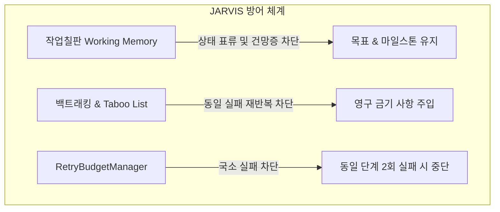
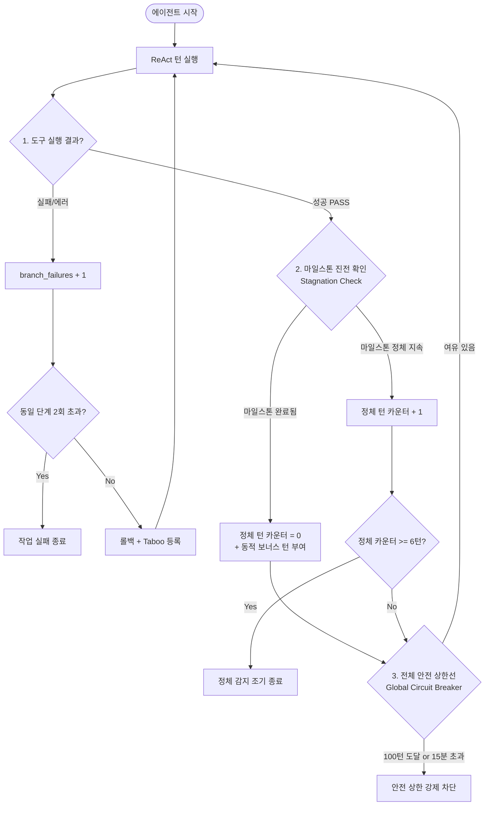

# JARVIS 에이전트 턴 제어 및 종료 정책 설계서
(Agent Turn Management & Termination Policy Architecture)

> **문서 버전**: v1.0  
> **작성일**: 2026-09-18  
> **상태**: 검토 대기 (For Review & Feedback)  
> **관련 모듈**: `src/jarvis/brain/agent.py`, `src/jarvis/brain/evaluator.py`, `src/jarvis/brain/checkpoint.py`, `src/jarvis/brain/memory.py`

---

## 1. 배경 및 문제 제기

### 1.1 기존 고정 턴수(`max_turns`)의 한계
현재 JARVIS ReAct 루프는 실행 시 `max_turns` (기본 15턴 등)의 고정 상한을 가지고 있습니다.
이 방식은 단순 스크립트에는 유효하지만, 다음과 같은 치명적인 문제를 안고 있습니다:

1. **정상 대형 작업의 강제 중단 (False Negative)**
   * 10개 채널 주문서 파싱, 대규모 엑셀 병합, 20페이지 웹 스크래핑 등 정상 작업 자체가 30~50턴을 요구하는 경우, 에이전트가 완벽하게 일하고 있음에도 불구하고 턴수 부족으로 실패 처리됨.
2. **경직된 실행 제어**
   * 작업의 난이도와 데이터 크기는 동적인데, 제어 정책이 정적인 턴 상한에 묶여 있음.

### 1.2 핵심 질문 (Core Question)
> **"우리는 작업칠판(Blackboard)과 백트래킹(Taboo List)을 도입했기 때문에 전체 턴수를 제한할 필요가 없는 것이 아닌가? 동일한 단계를 실패했을 때만 턴수를 제한하면 충분하지 않은가?"**

---

## 2. JARVIS 아키텍처의 고유 방어력 분석

JARVIS는 단순 순차 ReAct 에이전트가 아니며, 이미 강력한 3대 보호 기제가 내장되어 있습니다.



### 2.1 작업칠판(Blackboard)의 방어력
* `WorkingMemory`는 현재 단계(`current_phase`), 마일스톤(`milestones`), 발견 사실(`key_findings`)을 구조화하여 매 턴 프롬프트 상단에 주입합니다.
* 턴이 길어져도 **"내가 지금 무엇을 하고 있는가"에 대한 컨텍스트 표류(Drift)나 기억 상실(Amnesia)이 원천 차단**됩니다.

### 2.2 Taboo List 기반 실패 교훈 보존 (`checkpoint.py`)
* 백트래킹(롤백)이 발생해도 실패 원인은 휘발되지 않고 `accumulated_taboo`에 영구 보존됩니다.
```python
# checkpoint.py
if failure_reason:
    clean_reason = failure_reason.strip()
    if clean_reason not in self.accumulated_taboo:
        self.accumulated_taboo.append(clean_reason)

for lesson in self.accumulated_taboo:
    if lesson not in restored_memory.taboo_list:
        restored_memory.taboo_list.append(lesson)
```
* 복원된 작업칠판 상단에 `⚠️ [TABOO LIST & LESSONS LEARNED]`로 명시되므로, **LLM이 동일한 실패 방식을 다시 시도하는 일은 구조적으로 방어**됩니다.

### 2.3 동일 단계 실패 한도 (`RetryBudgetManager`)
* 한 마일스톤 단계에서 연속 2회(`max_retries_per_branch=2`) 실패하면 작업을 즉시 중단하므로, **특정 단계에서 영원히 헛도는 국소 무한 루프도 방어**됩니다.

---

## 3. "전체 턴수를 완전히 없앨 때" 발생하는 유일한 사각지대

사용자분의 직관대로 **"실패한 단계 제한 + Taboo 누적"** 덕분에 실패 루프는 완벽히 방어됩니다.  
하지만 전체 턴수를 **완전히 무제한(Infinite)**으로 둘 경우, 실패가 아닌 상황에서 단 하나의 사각지대가 발생합니다.

### 3.1 '진전 없는 성공'의 공회전 (Stagnant Success / Semantic Wandering)

도구 실행이 **성공(PASS)**하면 `branch_failure` 카운트가 올라가지 않고 `taboo_list`에도 들어가지 않습니다:

```text
[Turn 1] search_files(directory="orders") ──> 성공 (파일 5개 발견, PASS)
[Turn 2] read_excel(file="order_A.xlsx")  ──> 성공 (PASS)
[Turn 3] read_excel(file="order_B.xlsx")  ──> 성공 (PASS)
[Turn 4] find_in_file(...)                ──> 성공 (PASS)
[Turn 5] read_text(...)                   ──> 성공 (PASS)
...
[Turn 40] search_files(directory="backup") ──> 성공 (PASS)
```

* **원인**: 도구들이 예외 없이 정상 응답을 반환하므로 Evaluator는 항상 PASS 판정을 내립니다.
* **증상**: LLM은 매 턴 칠판에 *"새로운 단서를 조사 중입니다"*라고 업데이트하지만, 실제 최종 산출물이나 마일스톤 전환 없이 **관측(Observation)만 끝없이 반복**할 수 있습니다.
* **결과**: 실패가 한 번도 발생하지 않았으므로 `branch_failure`로도 걸리지 않고, 무제한 턴 상태라면 API 과금 및 프로세스 무한 점유가 발생합니다.

---

## 4. 제안: 계층형 턴 거버넌스 (Layered Turn Governance)

"작업을 억압하지 않으면서도 시스템 폭주를 100% 방지"하기 위해 다음 4계층 설계를 제안합니다.



### 계층 1: 국소 실패 제어 (Branch Retry Budget) — *현재 완비*
* **역할**: 동일 단계에서 2회 실패 시 롤백 및 Taboo 등록, 2회 모두 소진 시 즉시 중단.
* **기준**: `max_retries_per_branch = 2`

### 계층 2: 정체 감지 브레이커 (Stagnation Detector) — *신규 제안*
* **역할**: "도구는 성공하지만 목표로 나아가지 않는 공회전" 감지.
* **메커니즘**:
  * 마일스톤의 상태(`IN_PROGRESS`, `DONE`)가 **연속 5~6턴 동안 전혀 변경되지 않는 경우**.
  * 1차: LLM에게 *"경고: 5턴 동안 마일스톤에 진전이 없습니다. 즉시 다음 단계 도구를 실행하거나 실패를 선언하십시오."* 주입.
  * 2차(6턴째 지속 시): DEAD_END로 판정하여 중단.

### 계층 3: 진행도 기반 동적 턴 연장 (Progress-Aware Turns) — *신규 제안*
* **역할**: 대형 작업을 턴수 부족으로 끊지 않고 자연스럽게 완주하도록 지원.
* **메커니즘**:
  * 시작 기본 턴: 15턴
  * **마일스톤(`milestones`)이 하나씩 완료(`DONE`)될 때마다 `+10턴` 자동 충전**.
  * 즉, 4개 마일스톤으로 구성된 대형 작업은 최대 `15 + (4 * 10) = 55턴`까지 합법적으로 실행 가능.

### 계층 4: 최후 안전망 (Global Circuit Breaker)
* **역할**: 모델 환각, 버그, 무한 쿼리로 인한 API 과금 및 서버 다운 방지.
* **기준**: 작업 억압용이 아니므로 **100턴** 또는 **타임아웃(Wall-clock 15분)**으로 매우 넉넉하게 설정.

---

## 5. 기존 방식 vs 제안 방식 비교

| 구분 | 기존 방식 (Fixed Turn) | 사용자 아이디어 (Only Branch Failure) | 제안 방식 (Progress-Aware + Stagnation) |
| :--- | :--- | :--- | :--- |
| **전체 턴수** | 15턴 고정 (경직됨) | 완전 무제한 | 기본 15턴 + **마일스톤당 +10턴 충전** (최대 100턴 안전선) |
| **정상 대형 작업 처리** | ❌ 15턴 초과 시 강제 중단 | ✅ 완벽 지원 | ✅ **완벽 지원 (마일스톤 진전 시 지속 연장)** |
| **동일 단계 반복 실패** | ⚠️ 턴 소모로 종료 | ✅ Taboo + 백트래킹으로 차단 | ✅ Taboo + 백트래킹으로 차단 |
| **공회전 (성공만 반복)** | ❌ 15턴까지 돈 후 중단 | ❌ **영구 무한 루프 위험** | ✅ **정체 감지기(Stagnation)로 5턴 내 차단** |
| **API 과금 폭탄 위험** | 낮음 | **높음** | **원천 차단** |

---

## 6. 결론 및 향후 적용 로드맵

1. **사용자분의 견해("정상 작업에 대해 턴수를 작게 제한할 필요는 없으며, 동일 단계 실패에 집중해야 한다")는 매우 정확한 방향입니다.**
2. 따라서 기존의 `max_turns = 15` 고정 제한을 제거하거나 기본 상한을 대폭 풀되,
3. 남은 단 하나의 위험인 **"진전 없는 공회전"**을 막기 위해 **`마일스톤 정체 감지(Stagnation Detector)`**와 **`마일스톤 완료 시 턴 충전(Progress-aware turn)`**을 도입하는 것이 가장 이상적인 완성형 아키텍처입니다.
