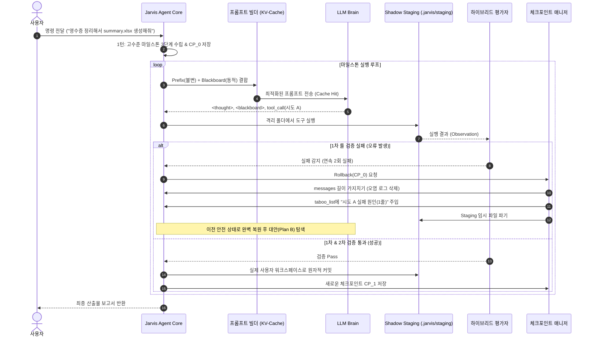

# 🧠 JARVIS Working Memory (칠판) & Tree-of-Thought 백트래킹 아키텍처 설계서

- **문서 버전**: v1.0.0
- **작성 일자**: 2026-09-04
- **상태**: 구현 예정 명세 (Draft for Next Sprint)
- **대상 모듈**: `src/jarvis/brain/memory.py`, `src/jarvis/brain/agent.py`

---

## 1. 아키텍처 개요 (Overview)

기존의 ReAct 에이전트는 대화 기록(`messages`)을 선형(Linear)으로만 덧붙이며 실행됩니다. 이 방식은 **(1) 실패 시 컨텍스트 오염**, **(2) 로컬 LLM의 토큰 윈도우 한계 및 속도 저하**, **(3) 막다른 길(Dead End) 진입 시 무한 루프**라는 치명적인 한계를 갖습니다.

본 설계는 **OpenAI o1/o3 및 Gemini Thinking 모델의 추론 메커니즘**을 차용하여,
1. **작업 칠판 (Stateful Working Memory / Blackboard)**: 현재 목표, 중간 발견 사항, 진행 체크리스트를 능동적으로 기록/수정.
2. **트리 탐색 & 백트래킹 (Tree-of-Thought with Rollback)**: 가설 검증 실패 시 불필요한 실패 로그를 잘라내고(Pruning), 안전한 직전 체크포인트로 돌아가 대안(Plan B)을 탐색.

---

2. **KV 캐시 무효화 (Cache Miss)**: 매 턴 시스템 프롬프트 상단이나 전체 구조가 가변적으로 변하면 KV 캐시를 전혀 재사용하지 못해 첫 토큰 생성 시간(TTFT)과 연산 비용이 급증.
3. **막다른 길(Dead End) 무한 루프**: 실패한 가설에 갇혀 동일한 오류 도구 호출을 반복하는 자가 합리화(Self-deception) 현상.
4. **실제 파일시스템 오염**: 실패한 작업 과정에서 생성된 불완전한 임시 파일이나 깨진 산출물이 사용자 디스크에 그대로 잔존.

본 설계는 **일반 노트북 환경(MVP)의 경량성과 응답성을 최우선**으로 하면서, **작업 칠판(Stateful Blackboard)**, **KV-Cache 최적화 레이아웃**, **하이브리드 평가(Hybrid Evaluator)**, **Shadow Staging 파일 트랜잭션**, **컨텍스트 가지치기(Context Pruning) 기반 백트래킹**을 결합하여 고난도 멀티스텝 완주율을 극대화합니다.

---

## 2. 전체 시스템 구조도 (System Architecture)

```mermaid
flowchart TD
    User([사용자 명령]) --> InitPhase[1턴: 요청 구체화 & 계층형 고수준 마일스톤 생성]
    InitPhase --> AgentLoop[에이전트 실행 루프]

    subgraph PromptLayout [KV 캐시 재사용 최적화 프롬프트 구조]
        direction TB
        PrefixCache["📌 [불변 Prefix (KV Cache 100% Hit)]<br>1. 고정 시스템 지침 (Core Persona & Rules)<br>2. 도구 명세 (Tool Schemas)<br>3. 사용자 최종 목표 (Main Goal & Expected Output)"]
        DynamicState["📋 [최신 턴 직전 동적 주입 (Working State)]<br>1. 계층형 마일스톤 & 현재 Phase<br>2. 핵심 중간 발견 데이터 (Key Findings)<br>3. 실패 교훈 및 금지 목록 (Taboo List)"]
        RecentTurns["💬 [최근 대화 & 도구 실행 결과 (Context Pruned)]"]
        PrefixCache --> DynamicState --> RecentTurns
    end

    subgraph ExecutionAndEval [추론 ➔ 격리 실행 ➔ 하이브리드 검증]
        direction TB
        LLM[LLM Brain]
        LLM -->|듀얼 출력 파싱| Parsed["&lt;thought&gt; &lt;blackboard&gt; + Function Tool Call"]
        Parsed --> ShadowRun[도구 실행: .jarvis/staging/ 격리 공간]
        ShadowRun --> Evaluator{1차 결정론적 룰 평가<br>exit_code / 파일 생성 / 루프 감지}
    end

    subgraph BacktrackingEngine [체크포인트 & 롤백 엔진]
        direction TB
        CP[(안전 체크포인트 스냅샷)]
        RollbackJudge{롤백 트리거<br>2회 연속 실패 or LLM 자율 롤백}
        Prune[컨텍스트 오염 로그 전량 가지치기]
        Lesson[실패 원인 1~2줄 Taboo 요약 주입]
        Discard[Staging 임시 폴더 즉시 폐기]
        
        RollbackJudge -->|롤백 실행| Prune
        RollbackJudge -->|롤백 실행| Lesson
        RollbackJudge -->|롤백 실행| Discard
    end

    PromptLayout -.-> LLM
    Evaluator -->|통과 (Green)| Commit["실제 사용자 경로로 원자적 커밋 (Atomic Commit)<br>& 새로운 체크포인트 저장"]
    Evaluator -->|실패/이상 발생| RollbackJudge
    Commit --> NextTurn[다음 마일스톤/턴 진행]
    Discard -.->|직전 체크포인트 복원| AgentLoop

- **프롬프트 주입 방식**: 매 턴 시스템 프롬프트 상단에 `[현재 작업 칠판 상태]`로 렌더링되어 LLM이 항상 자신의 위치를 인지.
- **업데이트 도구**:
  - `update_memory(phase=..., add_findings=..., checklist_update=...)`

---

### 3.2. 체크포인트 & 백트래킹 엔진 (`SnapshotManager`)

주요 분기점마다 **(1) 칠판 상태**, **(2) 대화 메시지 길이**, **(3) 파일시스템 생성물 기록**을 스냅샷으로 보관합니다.

```python
class Checkpoint(BaseModel):
    checkpoint_id: str
    description: str
    turn: int
    memory_snapshot: WorkingMemory
    message_index: int  # messages 리스트의 길이
    created_artifacts: List[str]  # 해당 스텝에서 생성된 임시 파일 목록
```

#### 롤백(Rollback) 시 동작 절차:
1. **토큰 가지치기 (Context Pruning)**:
   - `messages = messages[:checkpoint.message_index]`
   - 실패 과정에서 발생한 수십~수백 줄의 에러 메시지/오염된 툴 출력을 대화창에서 완전히 삭제.
2. **칠판 복원 & 교훈 주입 (Lesson Injection)**:

#### 칠판 데이터 모델 (`WorkingMemory`):
```python
from pydantic import BaseModel, Field
from typing import List, Dict, Any, Optional

class Milestone(BaseModel):
    id: int
    title: str
    status: str = "TODO"  # "TODO" | "IN_PROGRESS" | "DONE" | "FAILED"

class WorkingMemory(BaseModel):
    """에이전트 전용 작업 칠판 (Working Memory)"""
    main_goal: str = Field(description="사용자가 요청한 최종 목표 및 산출물 형태")
    current_phase: str = Field(default="INIT", description="현재 활성화된 작업 단계")
    milestones: List[Milestone] = Field(default_factory=list, description="계층형 고수준 마일스톤")
    key_findings: Dict[str, Any] = Field(default_factory=dict, description="중간 발견 데이터/변수/경로")
    taboo_list: List[str] = Field(default_factory=list, description="실패한 경로 및 1~2줄 핵심 실패 교훈")
    retry_count: int = Field(default=0, description="현재 분기점에서의 재시도 횟수")
```

---

### 3.2. 태그 기반 듀얼 블록 입출력 인터페이스

경량 로컬 모델(Qwen, Llama 등)부터 API 모델까지 완벽히 호환되도록, 모델의 생각/칠판 제어는 XML 태그로 수신하고 도구 호출은 표준 Function Calling을 병행합니다.

#### LLM 응답 형식:
```xml
<thought>
현재 영수증 이미지 디렉터리의 파일 목록을 확인했으므로, 2단계인 OCR 텍스트 추출 단계로 전환한다.
</thought>
<blackboard>
phase: "OCR_EXTRACTION"
milestones:
  - id: 1, status: "DONE"
  - id: 2, status: "IN_PROGRESS"
findings:
  file_count: 12
  target_ext: ".png"
</blackboard>
```
- 파이썬 런타임이 정규식으로 `<thought>`와 `<blackboard>` 블록을 분리 추출하여 칠판 상태를 갱신.
- 도구 호출(`tool_calls`)은 기존 Function Calling 인터페이스를 그대로 실행.

---

### 3.3. 일반 노트북 최적화 하이브리드 평가자 (Hybrid Evaluator)

매 턴 LLM을 호출해 평가하면 노트북 환경에서 응답 지연이 2배로 증가합니다. 따라서 **결정론적 룰 우선 평가**를 적용합니다.


1. **Phase 1 (TDD)**: `WorkingMemory` 데이터 모델 및 기본 프롬프트 렌더러 구현 (`tests/unit/test_memory.py`)
2. **Phase 2 (TDD)**: `SnapshotManager` (체크포인트 생성, 가지치기 롤백) 구현
3. **Phase 3**: `JarvisAgent` 메인 루프에 메모리 주입 및 `rollback` 도구 연동
4. **Phase 4**: 고난도 멀티스텝 실전 시나리오(파일 교차 검증 및 오류 복구) 라이브 테스트

<blackboard>
phase: "DIRECTORY_SCAN"
update_milestones:
  - id: 1
    status: "IN_PROGRESS"
status: "CONTINUE"
</blackboard>
```
*동시에 LLM의 Tool Call 페이로드로 `scan_directory(path="C:/receipts", recursive=False)`가 반환됨.*

##### 시나리오 B: 막다른 길 감지 및 백트래킹 선언 시 (Dead End & Rollback Step)
도구 실행 결과 파일이 깨져 있거나 처리 불가능함을 LLM이 스스로 인지했을 때:
```xml
<thought>
data_utf8.csv 파일을 열어보았으나 인코딩이 깨져 파싱할 수 없습니다. 직전 분기점으로 롤백하고 원본 백업 폴더의 xlsx 파일을 사용하는 대안(Plan B)으로 전환해야 합니다.
</thought>
<blackboard>
phase: "PARSE_DATA"
status: "DEAD_END"
dead_end_reason: "data_utf8.csv 인코딩 파손 및 빈 데이터로 복구 불가능"
</blackboard>
```
*이 경우 별도의 도구를 호출하지 않고 `status: "DEAD_END"` 태그만으로 런타임이 즉시 직전 체크포인트로 롤백을 실행.*

##### 시나리오 C: 최종 작업 완료 시 (Task Completion Step)
도구 호출 없이 최종 보고서를 산출할 때:
```xml
<thought>
3단계 마일스톤인 '엑셀 취합 보고서 생성'과 '수치 무결성 검증'이 모두 완료되었습니다. 사용자에게 최종 산출물 경로와 요약을 보고합니다.
</thought>
<blackboard>
phase: "COMPLETED"
update_milestones:
  - id: 3
    status: "DONE"
status: "CONTINUE"
</blackboard>

요청하신 영수증 정리가 성공적으로 완료되었습니다.
- **총 처리 건수**: 12건
- **총 지출 합계**: 342,000원
- **최종 엑셀 파일**: `C:/receipts/summary_202609.xlsx`
모든 검증 테스트를 통과하여 안전하게 커밋되었습니다.
```

---

#### 3.2.3. 파이썬 런타임 파싱 및 방어적 복구 (Parser & Fallback Engine)

로컬 7B/14B 모델은 간혹 닫는 태그(`</blackboard>`)를 누락하거나 YAML 문법 오타를 낼 수 있으므로, 3단계 방어 파서를 구축합니다:

```python
import re
import yaml
from typing import Tuple, Dict, Any, Optional

class BlackboardOutputParser:
    """LLM 원시 텍스트에서 thought, blackboard 상태 델타, 사용자 텍스트를 안전하게 파싱"""
    
    THOUGHT_PATTERN = re.compile(r"<thought>(.*?)(?:</thought>|$)", re.DOTALL | re.IGNORECASE)
    BLACKBOARD_PATTERN = re.compile(r"<blackboard>(.*?)(?:</blackboard>|$)", re.DOTALL | re.IGNORECASE)

    @classmethod
    def parse(cls, raw_text: str) -> Dict[str, Any]:
        if not raw_text:
            return {"thought": "", "blackboard_delta": {}, "clean_text": ""}

        # 1. Thought 추출
        thought_match = cls.THOUGHT_PATTERN.search(raw_text)
        thought = thought_match.group(1).strip() if thought_match else ""

        # 2. Blackboard 추출 및 파싱
        blackboard_delta = {}
        bb_match = cls.BLACKBOARD_PATTERN.search(raw_text)
        if bb_match:
            bb_raw = bb_match.group(1).strip()
            try:
                # YAML 파싱 시도 (JSON 상위 호환)
                parsed = yaml.safe_load(bb_raw)
                if isinstance(parsed, dict):
                    blackboard_delta = parsed
            except Exception:
                # Fallback: 단순 정규식 Key-Value 라인별 파싱
                for line in bb_raw.splitlines():
                    if ":" in line:
                        k, v = line.split(":", 1)
                        blackboard_delta[k.strip()] = v.strip().strip("\"'")

        return {
            "thought": thought,
            "blackboard_delta": blackboard_delta,
            "clean_text": clean_text
        }
```

- **안전장치 (Robust Fallback)**:
  - 모델이 태그를 아예 출력하지 않았더라도 전체 텍스트를 `clean_text`로 보존하고 기본 칠판 상태를 유지하여 루프 중단을 방지.
  - 다음 턴의 `messages`에는 장황한 원본 XML을 그대로 누적하지 않고 파싱된 핵심 상태만 칠판에 반영함으로써 **대화창 토큰 낭비(Token Overhead)를 차단**.

---

### 3.3. 일반 노트북 최적화 하이브리드 평가자 (Hybrid Evaluator)

매 턴 LLM을 호출해 평가하면 노트북 환경에서 응답 지연이 2배로 증가합니다. 따라서 **결정론적 룰 우선 평가**를 적용합니다.

1. **1차: 파이썬 결정론적 룰 평가 (Python Rule-based, 비용 0원/0ms)**:
   - CLI/스크립트 실행 시 `exit_code != 0` 감지
   - 필수 산출물 파일 미생성 감지
   - 동일 도구 동일 인자 2회 이상 반복 호출(루프) 감지
   - JSON 파싱 에러 및 스키마 위반 감지
2. **2차: 자율 반성 평가 (LLM Self-Reflection)**:
   - 1차 룰 검증을 통과한 산출물에 대해, 모델 스스로 `<thought>` 블록에서 목표 충족 여부를 판단.
   - 막다른 길(Dead End)이라고 판단되면 모델이 스스로 `<blackboard>status: "DEAD_END"</blackboard>`를 선언.

---

### 3.4. Shadow Staging & Atomic Commit (파일시스템 트랜잭션)

실제 사용자 워크스페이스를 직접 수정하면 롤백 시 잔여 파일이 남거나 원본이 파괴됩니다.

1. **Shadow Workspace 격리 (`.jarvis/staging/`)**:
   - 모든 파일 쓰기, 코드 생성, 임시 산출물은 `.jarvis/staging/{task_id}/` 아래에 격리 실행.
   - 파이썬 스크립트 실행이나 도구 호출 시 CWD 또는 대상 경로를 Staging 디렉토리로 라우팅.
2. **원자적 커밋 (Atomic Commit)**:
   - 평가자의 검증을 통과하여 체크포인트가 생성되는 시점에 Staging 파일들을 실제 사용자 작업 디렉토리로 안전하게 일괄 동기화(덮어쓰기).
3. **비가역 액션 승인 (Human-in-the-loop)**:
   - 원본 파일 삭제(`rm`, `delete`), 외부 메일/네트워크 전송, 시스템 설정 변경 등 되돌릴 수 없는 도구 액션은 실행 전 즉시 사용자 승인 대화창/프롬프트를 띄움.

---

### 3.5. 백트래킹 트리거, 컨텍스트 가지치기 & 재시도 예산

#### 1. 백트래킹 발동 조건 (Trigger):
- 룰 평가자에서 **동일 단계 2회 연속 실패** 감지 시
- LLM이 자율적으로 칠판에 `DEAD_END` 선언 시
- 치명적 검증 테스트 실패 시

#### 2. 롤백 실행 절차 (Rollback Sequence):
1. **컨텍스트 가지치기 (Context Pruning)**:
   - `messages = messages[:checkpoint.message_index]`
   - 실패 시도 중에 발생했던 수십 줄의 에러 메시지와 오염된 도구 호출 로그를 대화 기록에서 깨끗하게 절단.
2. **실패 원인 1~2줄 요약 주입 (Taboo Injection)**:
   - 칠판 상태를 직전 체크포인트로 복구하되, `taboo_list`에 실패 원인을 1~2줄 핵심 교훈으로 주입.
   - *(예: `"2024_03.csv는 인코딩이 CP949이며 컬럼이 비어있음 - 동일 방식으로 재접근 금지"`)*
3. **Staging 격리 폐기 (Staging Cleanup)**:
   - 실패한 분기에서 `.jarvis/staging/`에 생성된 깨진 파일들을 즉시 삭제/초기화.

#### 3. 재시도 예산 (Retry Budget):
- **분기점당 최대 재시도**: 2회
- **태스크 전체 최대 백트래킹**: 5회
- **예산 초과 시**: 에이전트가 무한 루프를 돌지 않고 즉시 멈추며, 사용자에게 구체적인 실패 요약과 함께 대안 방향을 질의(User Intervention).

---

### 3.6. 계층형 지연 계획 (Hierarchical Deferred Planning)

1. **1턴 (Initial Goal Refinement)**:
   - 사용자 입력을 받자마자 도구를 실행하지 않고, 사용자 목표를 정제하여 3~5개의 고수준 마일스톤을 칠판에 수립.
   - *(예: 1단계 환경 및 대상 파일 조사 ➔ 2단계 데이터 가공 ➔ 3단계 종합 보고서 작성)*
2. **지연된 세부 구현 (Deferred Execution)**:
   - 세부 도구 체이닝은 해당 마일스톤에 실제로 진입했을 때 턴 단위로 동적 수립.
   - 불필요한 사전 과대 계획(Over-planning) 및 환각을 방지.

---

## 4. 백트래킹 실행 시퀀스 다이어그램



---

## 5. 기존 코드베이스 대비 변경점 및 모듈 구성

| 모듈 경로 | 주요 변경 및 신규 추가 역할 |
|---|---|
| `src/jarvis/brain/memory.py` [NEW] | `WorkingMemory`, `Milestone` Pydantic 모델, 칠판 텍스트 포맷터, 태그 파서 |
| `src/jarvis/brain/checkpoint.py` [NEW] | `CheckpointManager`: 대화 인덱스 스냅샷, `taboo_list` 교훈 주입, 가지치기 |
| `src/jarvis/brain/evaluator.py` [NEW] | `HybridEvaluator`: 파이썬 룰 검사기(exit code, 파일 존재, 루프 감지), 재시도 예산 추적 |
| `src/jarvis/infra/staging.py` [NEW] | `ShadowWorkspace`: `.jarvis/staging` 격리, 원자적 덮어쓰기(Commit), 롤백 폐기 |
| `src/jarvis/brain/agent.py` [MODIFY] | ReAct 루프를 [계층 계획 ➔ KV 프롬프트 조립 ➔ 격리 실행 ➔ 평가 ➔ 커밋/롤백] 구조로 리팩토링 |

---
   - `messages = messages[:checkpoint.message_index]`
   - 실패 시도 중에 발생했던 수십 줄의 에러 메시지와 오염된 도구 호출 로그를 대화 기록에서 깨끗하게 절단.
2. **실패 원인 1~2줄 요약 주입 (Taboo Injection)**:
   - 칠판 상태를 직전 체크포인트로 복구하되, `taboo_list`에 실패 원인을 1~2줄 핵심 교훈으로 주입.
   - *(예: `"2024_03.csv는 인코딩이 CP949이며 컬럼이 비어있음 - 동일 방식으로 재접근 금지"`)*
3. **Staging 격리 폐기 (Staging Cleanup)**:
   - 실패한 분기에서 `.jarvis/staging/`에 생성된 깨진 파일들을 즉시 삭제/초기화.

#### 3. 재시도 예산 (Retry Budget):
- **분기점당 최대 재시도**: 2회
- **태스크 전체 최대 백트래킹**: 5회
- **예산 초과 시**: 에이전트가 무한 루프를 돌지 않고 즉시 멈추며, 사용자에게 구체적인 실패 요약과 함께 대안 방향을 질의(User Intervention).

---

### 3.7. 계층형 지연 계획 (Hierarchical Deferred Planning)

1. **1턴 (Initial Goal Refinement)**:
   - 사용자 입력을 받자마자 도구를 실행하지 않고, 사용자 목표를 정제하여 3~5개의 고수준 마일스톤을 칠판에 수립.
   - *(예: 1단계 환경 및 대상 파일 조사 ➔ 2단계 데이터 가공 ➔ 3단계 종합 보고서 작성)*
2. **지연된 세부 구현 (Deferred Execution)**:
   - 세부 도구 체이닝은 해당 마일스톤에 실제로 진입했을 때 턴 단위로 동적 수립.
   - 불필요한 사전 과대 계획(Over-planning) 및 환각을 방지.

---

## 4. 백트래킹 실행 시퀀스 다이어그램

```mermaid
sequenceDiagram
    autonumber
    actor User as "사용자"
    participant Agent as "Jarvis Agent Core"
    participant Prompt as "프롬프트 빌더 (KV-Cache)"
    participant LLM as "LLM Brain"
    participant Shadow as "Shadow Staging (.jarvis/staging)"
    participant Eval as "하이브리드 평가자"
    participant CP as "체크포인트 매니저"

    User->>Agent: 명령 전달 ("영수증 정리해서 summary.xlsx 생성해줘")
    Agent->>Agent: 1턴: 고수준 마일스톤 3단계 수립 및 CP_0 저장
    
    loop 마일스톤 실행 루프
        Agent->>Prompt: Prefix(불변) + Blackboard(동적) 결합
        Prompt->>LLM: 최적화된 프롬프트 전송 (Cache Hit)
        LLM-->>Agent: thought / blackboard 태그 및 tool_call (시도 A)
        
        Agent->>Shadow: 격리 폴더에서 도구 실행
        Shadow-->>Eval: 실행 결과 (Observation)
        
        alt 1차 룰 검증 실패 (오류 발생)
| 저장 시점 (Trigger) | 생성 조건 및 사유 | 스냅샷 식별자 예시 |
|---|---|---|
| **1. 시작 초기점** | 1턴에서 요청 구체화 및 고수준 마일스톤 수립 직후 | `cp_0_init` |
| **2. 마일스톤 완료점** | 특정 마일스톤 작업이 끝나고 **1차 룰 검증(Green)을 통과한 직후** | `cp_1_milestone_1_done` |
| **3. 원자적 커밋 직후** | Staging 임시 파일들이 실제 사용자 디스크로 동기화(Commit)된 직후 | `cp_2_commit_summary_xlsx` |
| **4. 비가역 액션 직전** | 파일 삭제/외부 전송 등 Human-in-the-loop 승인 요청 직전 | `cp_pre_delete_backup` |

> 🚫 **저장하지 않는 시점 (Skip Policy - 오버헤드 0)**:
> - 단순 파일 읽기(`read_file`), 디렉터리 조회(`scan_directory`), 검색 등의 Read-only 턴
> - 도구 실행 결과 에러(`exit_code != 0`)가 발생한 실패 턴 (오염된 상태는 절대 체크포인트로 만들지 않음)

##### 2. Level 2: 전제 붕괴 시 Root 체크포인트 롤백 (Root Rollback & Re-generation)
- **상황**: 초기 가설 자체가 완전히 틀려 현재 마일스톤 구조로는 도저히 목표를 달성할 수 없는 경우 (예: "텍스트 파싱 계획을 세웠으나 실제 파일은 OCR이 필요한 이미지 스캔본").
- **동작**:
  1. LLM이 `<blackboard>status: "DEAD_END", scope: "GLOBAL_PLAN"</blackboard>` 선언 또는 동일 마일스톤 2회 연속 실패.
  2. 시스템이 `cp_0_init` (시작점)으로 완전 롤백.
  3. 실패 시도의 대화창 오염 로그는 전량 삭제(Context Pruning).
  4. **★ 핵심 보존 원칙**: 실패 시도 중에 얻은 **핵심 발견 사항(`key_findings: {file_type: "scanned_image"}`)**과 **실패 교훈(`taboo_list: ["일반 텍스트 파서 접근 금지 - OCR 필요"]`)**은 초기화하지 않고 칠판에 그대로 유지!
  5. LLM은 보존된 교훈을 프롬프트에서 확인하고, 1턴에서 완전히 새로운 마일스톤 계획(Plan B)을 즉시 재생성하여 출발.

##### 3. Level 3: 사용자 에스컬레이션 (Human Escalation)
- Root 전면 재계획은 **태스크당 최대 1회**로 엄격히 제한.
- 1회 전면 재계획 후에도 또다시 전제 붕괴가 발생할 경우, 모델이 억지로 추론을 반복하지 않고 사용자에게 현재 상황과 막힌 원인을 보고하고 대화로 개입 요청.

---

## 4. 백트래킹 실행 시퀀스 다이어그램

```mermaid
sequenceDiagram
    autonumber
    actor User as "사용자"
    participant Agent as "Jarvis Agent Core"
    participant Prompt as "프롬프트 빌더 (KV-Cache)"
    participant LLM as "LLM Brain"
    participant Shadow as "Shadow Staging (.jarvis/staging)"
    participant Eval as "하이브리드 평가자"
    participant CP as "체크포인트 매니저"

    User->>Agent: 명령 전달 ("영수증 정리해서 summary.xlsx 생성해줘")
    Agent->>Agent: 1턴: 고수준 마일스톤 3단계 수립 및 CP_0 저장
    
    loop 마일스톤 실행 루프
        Agent->>Prompt: Prefix(불변) + Blackboard(동적) 결합
        Prompt->>LLM: 최적화된 프롬프트 전송 (Cache Hit)
        LLM-->>Agent: thought / blackboard 태그 및 tool_call (시도 A)
        
        Agent->>Shadow: 격리 폴더에서 도구 실행
        Shadow-->>Eval: 실행 결과 (Observation)
        
        alt 1차 룰 검증 실패 (오류 발생)
            Eval-->>Agent: 실패 감지 (연속 2회 실패)
            Agent->>CP: Rollback(CP_0) 요청
            CP->>Agent: messages 길이 가지치기 (오염 로그 삭제)
            CP->>Agent: taboo_list에 "시도 A 실패 원인(1줄)" 주입
            CP->>Shadow: Staging 임시 파일 파기
            Note over Agent,LLM: 이전 안전 상태로 완벽 복원 후 대안(Plan B) 탐색
        else 1차 및 2차 검증 통과 (성공)
            Eval-->>Agent: 검증 Pass
            Agent->>Shadow: 실제 사용자 워크스페이스로 원자적 커밋
            Agent->>CP: 새로운 체크포인트 CP_1 저장
        end
    end
    Agent-->>User: 최종 산출물 보고서 반환
```

---

## 5. 기존 코드베이스 대비 변경점 및 모듈 구성

| 모듈 경로 | 주요 변경 및 신규 추가 역할 |
|---|---|
| `src/jarvis/brain/memory.py` [NEW] | `WorkingMemory`, `Milestone` Pydantic 모델, 칠판 텍스트 포맷터, 태그 파서 |
| `src/jarvis/brain/checkpoint.py` [NEW] | `CheckpointManager`: 대화 인덱스 스냅샷, `taboo_list` 교훈 주입, 가지치기 |
| `src/jarvis/brain/evaluator.py` [NEW] | `HybridEvaluator`: 파이썬 룰 검사기(exit code, 파일 존재, 루프 감지), 재시도 예산 추적 |
| `src/jarvis/infra/staging.py` [NEW] | `ShadowWorkspace`: `.jarvis/staging` 격리, 원자적 덮어쓰기(Commit), 롤백 폐기 |
| `src/jarvis/brain/agent.py` [MODIFY] | ReAct 루프를 [계층 계획 ➔ KV 프롬프트 조립 ➔ 격리 실행 ➔ 평가 ➔ 커밋/롤백] 구조로 리팩토링 |

---

## 6. 구현 로드맵 (TDD 중심 단계별 계획)

- [ ] **Phase 1: WorkingMemory & KV 캐시 렌더러 구현 (TDD)**
  - `tests/unit/test_memory.py` 작성
  - `WorkingMemory` 스키마 및 `<thought>`, `<blackboard>` 파서 구현
  - Prefix 불변 캐시 영역과 동적 칠판 주입 렌더링 검증
- [ ] **Phase 2: Shadow Staging 및 파일 트랜잭션 관리자 (TDD)**
  - `tests/unit/test_staging.py` 작성
  - 임시 디렉터리 생성, 파일 생성 격리, 원자적 동기화(Commit), 롤백 파기 기능 검증
  - 비가역 작업(삭제, 외부 전송) 차단 및 승인 인터페이스 연동
- [ ] **Phase 3: Checkpoint & Context Pruning 백트래킹 엔진 (TDD)**
  - `tests/unit/test_checkpoint.py` 작성
  - 스냅샷 생성, 메시지 히스토리 가지치기(오염 로그 제거), `taboo_list` 1줄 요약 주입 검증
- [ ] **Phase 4: Hybrid Evaluator & 재시도 예산 관리자 (TDD)**
  - `tests/unit/test_evaluator.py` 작성
  - 도구 에러/루프 감지 룰 및 분기당 2회/총 5회 예산 초과 방어 로직 검증
- [ ] **Phase 5: JarvisAgent 메인 루프 통합 및 고난도 시나리오 검증**
  - `tests/integration/test_agent_backtracking.py`
  - 일부러 깨진 파일/잘못된 경로를 제공하고 스스로 롤백하여 대안을 찾아 완주하는 실전 테스트 수행

    Agent-->>User: 최종 산출물 보고서 반환
```

---

---

## 5. 기존 코드베이스 대비 변경점 및 모듈 구성

| 모듈 경로 | 구분 | 주요 변경 및 신규 추가 역할 |
|---|:---:|---|
| `src/jarvis/brain/memory.py` | **NEW** | `WorkingMemory`, `Milestone`, `ArtifactSnapshot` Pydantic 모델, 3단계 방어 파서(`BlackboardOutputParser`), KV-Cache Safe 프롬프트 빌더, 칠판 델타 병합기 |
| `src/jarvis/brain/evaluator.py` | **NEW** | `UniversalRuleEvaluator`(도구 무종속 3대 룰 + 파일 실재성 검증), `HybridEvaluator`(1차 룰 + 2차 자율 반성), `RetryBudgetManager`(분기 2회 / 총 5회 캡) |
| `src/jarvis/brain/checkpoint.py` | **NEW** | `Checkpoint` 모델, `CheckpointManager`(안전 시점 Skip Policy 스냅샷, `message_index` 기반 컨텍스트 가지치기, `taboo_list` 1줄 요약 주입) |
| `src/jarvis/infra/staging.py` | **NEW** | `ShadowWorkspace`(`.jarvis/staging/{task_id}` 격리 샌드박스), 원자적 커밋(`commit_to_workspace`), 롤백 즉시 파기(`discard`) |
| `src/jarvis/tools/registry.py` | **MODIFY** | `ToolRegistry.execute()`에 1차 범용 룰 인터셉터 연동 및 Staging 격리 디렉토리(CWD) 라우팅 지원 |
| `src/jarvis/brain/agent.py` | **MODIFY** | 기존 선형 루프를 [1턴 마일스톤 생성 ➔ KV 프롬프트 조립 ➔ LLM 듀얼 출력 ➔ Staging 격리 실행 ➔ 하이브리드 평가 ➔ 커밋/롤백 순환] 5단계 라이프사이클로 전면 리팩토링 |
| `src/jarvis/utils/config.py` | **MODIFY** | `staging_dir`, 분기당 최대 재시도(`max_retries_per_branch=2`), 전체 재시도 예산(`total_retry_budget=5`) 등 백트래킹 설정 필드 확장 |

---

## 6. 구현 로드맵 (TDD 중심 단계별 계획)

- [ ] **Phase 1: WorkingMemory, 방탄 파서 & KV 캐시 렌더러 구현 (TDD)**
  - `tests/unit/test_memory.py` 작성
  - `WorkingMemory` 모델, 3단계 방어 파서(`BlackboardOutputParser`), 델타 병합기 구현
  - Prefix 불변 캐시 영역과 동적 칠판 주입 렌더링 검증
- [ ] **Phase 2: Shadow Staging 및 파일 트랜잭션 관리자 (TDD)**
  - `tests/unit/test_staging.py` 작성
  - `.jarvis/staging/` 임시 격리 디렉터리 생성, 파일 생성 격리, 원자적 동기화(Commit), 롤백 파기(`discard`) 기능 검증
  - 비가역 작업(삭제, 외부 전송) 차단 및 승인 인터페이스 연동
- [ ] **Phase 3: Universal Rule Evaluator & Hybrid Evaluator 구현 (TDD)**
  - `tests/unit/test_evaluator.py` 작성
  - 도구 무종속 3대 룰(무한루프, 예외/에러, 빈 결과) 및 파일 실재성/0바이트 빈 파일 감지 인터셉터 검증
  - LLM 자율 반성(`DEAD_END`) 파싱 및 분기당 2회 / 총 5회 재시도 예산 하드 캡 검증
- [ ] **Phase 4: Checkpoint & Context Pruning 백트래킹 엔진 (TDD)**
  - `tests/unit/test_checkpoint.py` 작성
  - 안전 입증 시점 선택적 스냅샷(Skip Policy), `message_index` 기반 오염 로그 가지치기, `taboo_list` 1줄 요약 주입 검증
- [ ] **Phase 5: JarvisAgent 메인 루프 통합, ToolRegistry 연동 & 고난도 시나리오 검증**
  - `src/jarvis/tools/registry.py` 인터셉터 및 `src/jarvis/utils/config.py` 연동
  - `tests/unit/test_agent.py` 작성 (모의 프로바이더 기반 5단계 라이프사이클 검증)
  - `tests/integration/test_agent_backtracking.py`
  - 일부러 깨진 파일/잘못된 경로를 제공하고 스스로 롤백하여 대안을 찾아 완주하는 실전 E2E 테스트 수행
