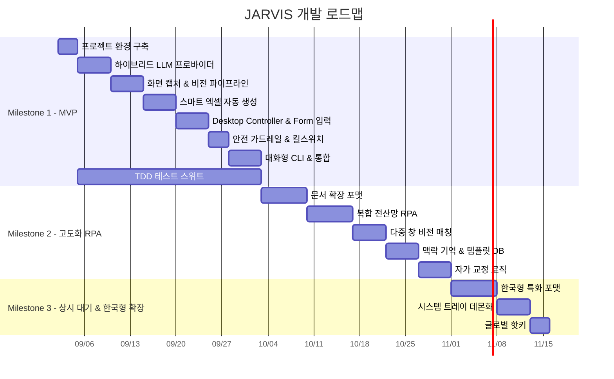

# 🗺️ JARVIS 전체 개발 로드맵 (Development Roadmap)

> **문서 버전**: v0.1.0
> **작성일**: 2026-09-02
> **기준 문서**: [JARVIS_SPEC.md (PRD)](./JARVIS_SPEC.md)
> **개발 환경**: Windows 10/11, Python 3.11+, RTX 4070 Super (VRAM 12GB)

---

## 개발 단계 전체 개요 (Overview)



---

## 📌 Milestone 1: 코어 프레임워크 & 파일/GUI 자동화 MVP

> **목표**: 화면 캡처 → AI 비전 분석 → 스마트 엑셀 자동 생성 + GUI 양식 자동 입력의 **핵심 파이프라인**을 엔드투엔드로 완성한다.

### Phase 1-1: 프로젝트 환경 구축

| # | 태스크 | 상세 내용 | 산출물 |
|:---:|:---|:---|:---|
| 1 | Python 가상환경 & 의존성 설정 | `venv` 생성, `requirements.txt` 핵심 패키지 정의 | `requirements.txt` |
| 2 | 프로젝트 디렉터리 구조 생성 | `src/jarvis/` 하위 모듈 디렉터리 스캐폴딩 | 표준 프로젝트 구조 |
| 3 | 환경 설정 파일 구성 | `.env.example`, `config.yaml` 스키마 정의 (API 키, 모델명, 출력 경로, 딜레이 등) | `config/` |
| 4 | 기본 로깅 & 에러 핸들링 | Python `logging` 기반 로거 구축 | `src/jarvis/utils/` |

---

### Phase 1-2: 하이브리드 LLM 프로바이더

| # | 태스크 | 상세 내용 | 산출물 |
|:---:|:---|:---|:---|
| 1 | LLM 프로바이더 인터페이스 설계 | `BaseLLMProvider` 추상 클래스 (공통 `generate()`, `generate_with_image()` 인터페이스) | `src/jarvis/providers/base.py` |
| 2 | Gemini 프로바이더 구현 | `google-genai` SDK 연동, `gemini-3.6-flash` / `gemini-2.5-pro` 지원 | `src/jarvis/providers/gemini.py` |
| 3 | Ollama 프로바이더 구현 | `ollama-python` SDK 연동, `qwen2.5:14b` 기본 모델 | `src/jarvis/providers/ollama.py` |
| 4 | 연결 실패 안전 중단 (Fail-Safe) | API 키 누락 / 네트워크 단절 / Ollama 미실행 시 명확한 한국어 오류 메시지 및 설정 가이드 출력 후 안전 중단 | 각 프로바이더 내 예외 처리 |
| 5 | 프로바이더 팩토리 | 설정 파일 기반 `gemini` / `ollama` 프로바이더 자동 선택 및 인스턴스 생성 | `src/jarvis/providers/factory.py` |

---

### Phase 1-3: 화면 캡처 & 비전 분석 파이프라인

| # | 태스크 | 상세 내용 | 산출물 |
|:---:|:---|:---|:---|
| 1 | 고속 화면 캡처 모듈 | `mss` 기반 전체 화면 / 활성 윈도우 / 영역 지정 캡처, `Pillow`로 이미지 전처리 | `src/jarvis/vision/capture.py` |
| 2 | 비전 분석기 (VLM 연동) | 캡처된 이미지를 Gemini Flash VLM에 전송하여 정형 데이터(JSON) 추출 | `src/jarvis/vision/analyzer.py` |
| 3 | Form Anchor 위치 감지 | 화면 내 UI 버튼/입력 필드 좌표 도출 (비전 기반) | `src/jarvis/vision/anchor.py` |
| 4 | 이미지/PDF 파일 입력 처리 | 로컬 이미지(`.png`, `.jpg`) 및 PDF(`.pdf`) 파일 로드 & Gemini Document API 연동 | `src/jarvis/vision/file_input.py` |

---

### Phase 1-4: 스마트 엑셀 자동 생성 엔진

| # | 태스크 | 상세 내용 | 산출물 |
|:---:|:---|:---|:---|
| 1 | 엑셀 생성기 코어 | `openpyxl`로 JSON 데이터 → `.xlsx` 자동 생성 (헤더 색상, 테두리, 열 너비 자동 맞춤) | `src/jarvis/office/excel_writer.py` |
| 2 | 엑셀 리더 & 병합 | 기존 `.xlsx` 파일 읽기, 데이터 병합 및 특정 시트 수정 | `src/jarvis/office/excel_reader.py` |
| 3 | CSV/TSV 입출력 | `.csv`, `.tsv` 데이터 읽기/내보내기 (인코딩 자동 감지: UTF-8 / CP949) | `src/jarvis/office/csv_handler.py` |
| 4 | AI 파일명 자동 작명 | LLM이 내용을 분석하여 적합한 파일명을 자동 생성 (예: `20260902_회식_영수증_정리.xlsx`) | `src/jarvis/office/file_namer.py` |
| 5 | 중복 파일명 넘버링 | 동일 이름 존재 시 `파일명_(1).xlsx`, `파일명_(2).xlsx` 자동 부여 | `src/jarvis/office/file_manager.py` |
| 6 | 출력 경로 단일화 | 설정된 `outputs/` 디렉터리로 모든 산출물 일원화 저장 | `src/jarvis/office/file_manager.py` |

---

### Phase 1-5: Desktop Controller & 양식 자동 입력

| # | 태스크 | 상세 내용 | 산출물 |
|:---:|:---|:---|:---|
| 1 | 마우스 제어 모듈 | `pyautogui` 기반 좌표 이동, 클릭, 더블클릭, 드래그, 스크롤 래퍼 | `src/jarvis/controller/mouse.py` |
| 2 | 키보드 제어 모듈 | 텍스트 타이핑, 단축키 조합 전송 (`Ctrl+C`, `Tab`, `Enter` 등) 래퍼 | `src/jarvis/controller/keyboard.py` |
| 3 | 안전 지연 시간 (Action Delay) | 모든 마우스/키보드 액션 간 설정 가능한 최소 대기 시간 (기본 `0.1s~0.5s`) 적용 | `src/jarvis/controller/base.py` |
| 4 | 하이브리드 양식(Form) 순차 입력기 | **1단계**: 비전 앵커링 — 화면 캡처 후 AI가 첫 번째 입력 필드 감지 및 클릭<br>**2단계**: 고속 순차 입력 — 정형 데이터를 바탕으로 필드 타이핑 ➡️ `Tab`/`Enter` 이동 반복 | `src/jarvis/controller/form_filler.py` |

---

### Phase 1-6: 안전 가드레일 & 킬스위치

| # | 태스크 | 상세 내용 | 산출물 |
|:---:|:---|:---|:---|
| 1 | 긴급 중단 킬스위치 | 마우스 모서리 Failsafe(`pyautogui`) + 글로벌 단축키(`Ctrl+Alt+S` / `Esc` 연타) 감지 시 전체 GUI 동작 즉시 종료 | `src/jarvis/guardrails/killswitch.py` |
| 2 | 파일 작업 승인 정책 | 위험 작업(삭제, 원본 수정) 사전 승인 요청 / 안전 작업(`outputs/` 내 신규 생성) 자율 실행 | `src/jarvis/guardrails/permissions.py` |
| 3 | 통신 실패 가드레일 | 네트워크 단절 / API 키 누락 시 작업 중단 및 명확한 설정 안내 가이드 출력 | `src/jarvis/guardrails/connectivity.py` |

---

### Phase 1-7: 대화형 CLI & 시스템 통합

| # | 태스크 | 상세 내용 | 산출물 |
|:---:|:---|:---|:---|
| 1 | Rich 터미널 CLI | `rich` 라이브러리 기반 대화형 작업 지시 입력 및 계획 보고 UI | `src/jarvis/cli/app.py` |
| 2 | 상호작용형 Planner | 사용자 자연어 지시 → AI가 작업 분해 → 단계별 엔진 선택지 제시 → 승인 후 실행 | `src/jarvis/brain/planner.py` |
| 3 | 엔드투엔드 파이프라인 통합 | CLI → Planner → 비전/LLM → 엑셀 생성 / GUI 제어 전체 흐름 연결 | `src/jarvis/main.py` |

---

### Phase 1-8: TDD 테스트 스위트 (전 Phase에 걸쳐 병행)

| # | 태스크 | 상세 내용 | 산출물 |
|:---:|:---|:---|:---|
| 1 | 단위 테스트 | 각 모듈(프로바이더, 캡처, 엑셀, 컨트롤러, 가드레일)별 `pytest` 단위 테스트 | `tests/unit/` |
| 2 | 통합 테스트 | 엔드투엔드 파이프라인 (이미지 입력 → 엑셀 출력) 통합 시나리오 검증 | `tests/integration/` |
| 3 | Mock & Fixture | Gemini/Ollama API 호출 모킹, 테스트용 샘플 이미지/엑셀 데이터 | `tests/fixtures/` |


## 📌 Milestone 2: 고도화된 오피스 & 엔드투엔드 자율 RPA

> **목표**: MVP 기반 위에 문서 확장 포맷, 복합 전산 자동 입력, 맥락 기억 등 **자율 오피스 RPA**를 완성한다.

### Phase 2-1: 문서 확장 포맷 지원

| # | 태스크 | 상세 내용 |
|:---:|:---|:---|
| 1 | PPT 템플릿 일괄 치환 엔진 | `python-pptx`로 명단/데이터 기반 슬라이드 내 이름/텍스트 자동 치환 |
| 2 | Word 문서 양식 작성 | `python-docx`로 계약서/보고서 표준 양식 텍스트 일괄 치환 |
| 3 | 대량 압축파일 일괄 처리 | `zipfile`로 `.zip` 해제 → 내부 이미지/PDF 자동 일괄 분석 파이프라인 |

### Phase 2-2: 엔드투엔드 복합 전산 RPA

| # | 태스크 | 상세 내용 |
|:---:|:---|:---|
| 1 | 비호환 앱 간 자동 데이터 이동 | 웹/PDF 데이터 인식 → 전산망/레거시 프로그램 창 자동 입력 |
| 2 | 다중 창 비전 매칭 | 화면 내 여러 윈도우 중 대상 창을 비전으로 찾아 정밀 UI 탐색 및 조작 |

### Phase 2-3: 학습 및 자가 교정

| # | 태스크 | 상세 내용 |
|:---:|:---|:---|
| 1 | 맥락 기억 & 사용자 템플릿 DB | 세션 내 작업 기록, 맞춤형 엑셀 서식/경로/명칭 규칙 영구 저장 (JSON/SQLite) |
| 2 | 자가 교정(Self-Correction) | 작업 실패 시 화면 재캡처 → 원인 분석 → 대안 계획 수립 → 재시도 루프 |
| 3 | 스마트 자동 모드 전환 | MVP '완전 대화형 모드' 실사용 피드백 기반, 빈번한 작업 패턴을 학습하여 자동 추천 실행 |

---

## 📌 Milestone 3: 상시 대기 및 한국형 특화 확장

> **목표**: 백그라운드 상시 대기 어시스턴트로 진화하고, **한국형 공문서 포맷**을 완벽 지원한다.

### Phase 3-1: 한국형 특화 포맷

| # | 태스크 | 상세 내용 |
|:---:|:---|:---|
| 1 | HWP/HWPX 읽기 및 작성 | `pyhwp` / `hwpx`로 관공서 공문 서식 일괄 읽기/치환/작성 |
| 2 | 전자세금계산서 XML 파싱 | 국세청 홈택스 표준 XML 전자세금계산서 내역 자동 파싱 및 엑셀 변환 |

### Phase 3-2: 상시 대기 백그라운드 어시스턴트

| # | 태스크 | 상세 내용 |
|:---:|:---|:---|
| 1 | 윈도우 시스템 트레이 등록 | 백그라운드 데몬으로 상주하며 시스템 트레이(Tray) 아이콘 표시 |
| 2 | 글로벌 핫키 즉시 호출 | 사용자가 지정한 글로벌 단축키로 언제든 JARVIS CLI 즉시 호출 |
| 3 | 플로팅 미니 위젯 | 작업 진행 상황 요약을 보여주는 최소화된 위젯 UI |

---

## 🔑 핵심 기술 스택 요약

| 영역 | 기술 / 라이브러리 | 용도 |
| :--- | :--- | :--- |
| **AI (클라우드)** | `google-genai` | Gemini 3.6 Flash/Pro 멀티모달 비전 및 추론 |
| **AI (로컬)** | `ollama-python` | Ollama + Qwen2.5 14B 오프라인 텍스트 처리 |
| **화면 캡처** | `mss`, `Pillow` | 고속 스크린 캡처 및 이미지 전처리 |
| **엑셀** | `openpyxl` | 서식 완비 `.xlsx` 생성/수정 |
| **GUI 제어** | `pyautogui` | 마우스/키보드 자동화 |
| **킬스위치** | `keyboard` | 글로벌 핫키 감지 (긴급 중단) |
| **CLI UI** | `rich` | 터미널 대화형 인터페이스 |
| **데이터 검증** | `pydantic` | 설정 값 및 데이터 스키마 유효성 검증 |
| **테스트** | `pytest`, `pytest-mock` | TDD 단위/통합 테스트 |

---

## 📁 프로젝트 디렉터리 구조 (예정)

```text
javis/
├── config/                    # 환경 설정
│   ├── .env.example           # API 키 템플릿
│   └── config.yaml            # 시스템 설정 (모델명, 딜레이, 출력 경로 등)
├── docs/                      # 문서
│   ├── JARVIS_SPEC.md         # 요구사항 명세서 (PRD)
│   └── DEVELOPMENT_ROADMAP.md # 본 개발 로드맵
├── outputs/                   # 자동 생성 산출물 기본 저장소
├── src/
│   └── jarvis/
│       ├── __init__.py
│       ├── main.py            # 엔트리포인트 & 파이프라인 통합
│       ├── brain/             # Planner (작업 분해 & 인터랙션)
│       │   └── planner.py
│       ├── providers/         # 하이브리드 LLM 엔진
│       │   ├── base.py        # 추상 인터페이스
│       │   ├── gemini.py      # Google Gemini 프로바이더
│       │   ├── ollama.py      # Ollama 로컬 프로바이더
│       │   └── factory.py     # 프로바이더 팩토리
│       ├── vision/            # 화면 캡처 & 비전 분석
│       │   ├── capture.py     # mss 기반 캡처
│       │   ├── analyzer.py    # VLM 비전 분석기
│       │   ├── anchor.py      # Form Anchor 위치 감지
│       │   └── file_input.py  # 이미지/PDF 파일 입력
│       ├── office/            # 엑셀/파일 자동화
│       │   ├── excel_writer.py
│       │   ├── excel_reader.py
│       │   ├── csv_handler.py
│       │   ├── file_namer.py  # AI 파일명 자동 작명
│       │   └── file_manager.py # 경로 단일화 & 중복 방지
│       ├── controller/        # GUI 마우스/키보드 제어
│       │   ├── base.py        # Action Delay 공통
│       │   ├── mouse.py
│       │   ├── keyboard.py
│       │   └── form_filler.py # 하이브리드 양식 순차 입력
│       ├── guardrails/        # 안전 가드레일
│       │   ├── killswitch.py  # 긴급 중단
│       │   ├── permissions.py # 파일 작업 승인 정책
│       │   └── connectivity.py # 통신 실패 가드레일
│       ├── cli/               # Rich 터미널 UI
│       │   └── app.py
│       └── utils/             # 공통 유틸리티
│           ├── logger.py
│           └── config.py      # 설정 로더
└── tests/                     # TDD 테스트 스위트
    ├── unit/                  # 단위 테스트
    ├── integration/           # 통합 테스트
    └── fixtures/              # 테스트용 샘플 데이터
```
