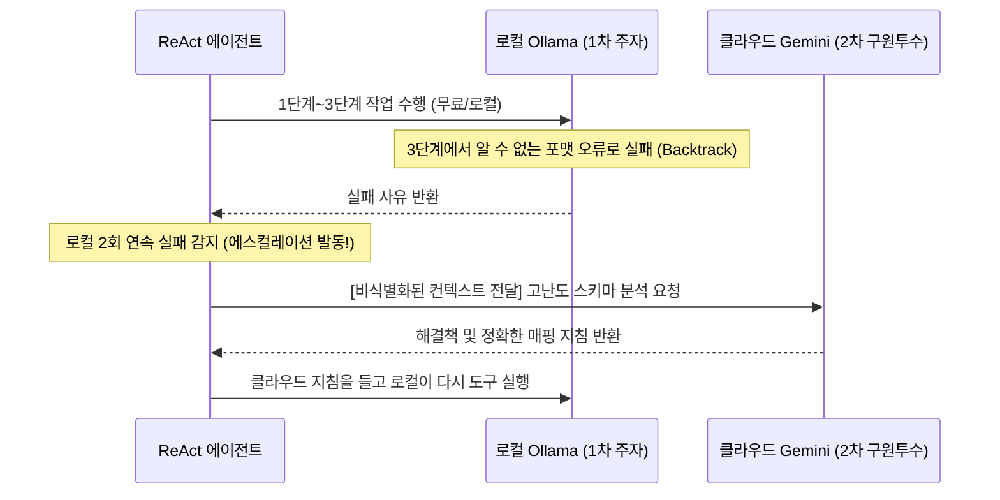

# JARVIS 듀얼 모델 하이브리드 라우팅 아키텍처 설계서
(Dual-Model Hybrid Architecture: Local Ollama + Cloud Gemini Routing Strategy)

> **문서 버전**: v0.1 (초안 / Draft for Design & Review)  
> **작성일**: 2026-09-21  
> **상태**: 신규 설계 검토 대기  
> **관련 모듈**: `src/jarvis/providers/factory.py`, `src/jarvis/providers/base.py`, `src/jarvis/providers/gemini.py`, `src/jarvis/providers/ollama.py`, `src/jarvis/brain/agent.py`

---

## 1. 개요 및 배경 (Context & Motivation)

### 1.1 현재 구현 상태 (Current Single Engine Baseline)
현재 JARVIS의 LLM 엔진은 `src/jarvis/providers/factory.py`를 통해 **완전한 단일 모델 택1(Single Provider)** 방식으로 동작합니다:
* **로컬 단독 모드**: `OllamaProvider` (Qwen2.5 14B) 100% 실행 (프라이버시 보장, 제로 API 비용, 오프라인 지원)
* **클라우드 단독 모드**: `GeminiProvider` (Gemini 2.5/3.0 Flash) 100% 실행 (초저사양 PC 지원, 빠른 클라우드 속도)

### 1.2 왜 하이브리드(혼합) 아키텍처가 필요한가?
실제 업무 자동화 현장에서는 단일 모델만으로 해결하기 어려운 상반된 요구사항이 존재합니다:

| 요구사항 | 로컬 LLM (Ollama 14B)의 현실 | 클라우드 LLM (Gemini Flash)의 현실 |
| :--- | :--- | :--- |
| **개인정보/사내 데이터 보안** | 🔒 **100% 안전** (외부 유출 제로) | ⚠️ 외부 API 전송으로 인한 컴플라이언스 이슈 |
| **API 비용 및 쿼터 제한** | 💰 **0원 (무제한 호출 가능)** | 💸 호출 턴수에 비례한 과금 발생 |
| **복잡한 비전(Vision) 분석** | ❌ 14B 텍스트 모델은 스크린샷 GUI 분석 불가 | 👁️ **초고속 멀티모달 비전 지원** |
| **초고난도 스키마 추론력** | ⚠️ 복잡한 중첩 엑셀 구조에서 간혹 추론 한계 | 🧠 **방대한 지식 기반의 강력한 추론력** |
| **로컬 GPU VRAM / 추론 속도** | ⏳ 긴 프롬프트 시 TTFT 15~30초 소요 가능 | ⚡ **턴당 1~2초 내외 초고속 응답** |

> 💡 **핵심 목표**:  
> **"보안이 필요한 일상 데이터와 대량 턴은 로컬 Ollama(0원/보안)가 처리하고, 고난도 비전 분석 및 막다른 길 해결은 클라우드 Gemini가 지원하는 최적의 동적 협업 체계 구축"**

---

## 2. 하이브리드 라우팅의 4대 아키텍처 패턴

```mermaid
graph TD
    UserRequest[사용자 업무 요청] --> Router{하이브리드 지능형 라우터<br/>HybridLLMRouter}
    
    %% 패턴 1: 모달리티/도메인 분기
    Router -->|GUI 스크린샷 / 비전 분석| CloudGemini[Gemini Flash<br/>(비전 / 대형 추론)]
    Router -->|고객 개인정보 / 단순 오피스 작업| LocalOllama[Local Ollama Qwen2.5<br/>(프라이버시 / 무료)]
    
    %% 패턴 2: 폴백 및 에스컬레이션
    LocalOllama -->|연속 실패 / Dead-End 발생| Escalation{에스컬레이션}
    Escalation --> CloudGemini
    
    %% 패턴 3: Supervisor-Worker
    CloudGemini -.->|전체 로드맵 및 고수준 계획 수립| LocalOllama
```

---

### 패턴 1: 모달리티 및 작업 유형 기반 정적 라우팅 (Task/Modal Routing)
가장 직관적이고 구현이 명확한 패턴입니다. 작업에 필요한 입력 형태(Modal)와 도구 유형에 따라 라우팅합니다.

* **로컬 Ollama 전담**:
  * 고객 주문서 파일 파싱, 텍스트 가공, 정규식 추출, OS 명령어 생성.
  * 개인정보(주소, 전화번호, 고객명)가 포함된 모든 오피스 문서 조작.
* **클라우드 Gemini 전담**:
  * 데스크톱 GUI 스크린샷 분석(비전 앵커 탐색), OCR 판독.
  * 10만 토큰 이상의 거대한 규정집/참고 문서 요약.

---

### 패턴 2: 난이도 에스컬레이션 및 폴백 (Escalation & Fallback Routing)
"평상시에는 0원인 로컬 LLM이 달리다가, 문제가 생기면 클라우드 형님을 호출하는 구조"입니다.



* **동작 원리**:
  1. 기본 턴은 로컬 Ollama가 저렴하고 안전하게 수행.
  2. 만약 로컬 모델이 동일 Phase에서 **2회 연속 실패하거나 `backtrack`을 선언할 위기**에 처하면,
  3. 컨텍스트에서 개인정보를 마스킹(Sanitize)한 후 **Gemini에게 "이 난제를 풀기 위한 정확한 전략/도구 인자"를 자문**하여 위기를 돌파.

---

### 패턴 3: 계층형 오케스트레이션 (Supervisor-Worker Pattern)
* **Supervisor (Gemini Flash)**:
  * 세션 시작 시 단 1회 호출.
  * 복잡한 사용자 요구사항을 분석하여 3~5개의 정밀한 마일스톤과 전략(작업칠판 초안)을 작성.
* **Worker (Local Ollama)**:
  * 작성된 작업칠판을 넘겨받아 로컬 환경에서 도구를 부르며 실제 노가다(파일 읽기/변환/검증)를 턴당 비용 없이 완수.

---

### 패턴 4: 프라이버시 가드레일 기반 데이터 라우팅 (Data Privacy Guardrail)
* 사용자의 민감 데이터 전송 동의 옵션에 따른 강제 규칙:
  * **Strict Private Mode (금융/의료/개인정보)**: 클라우드 호출 원천 차단 ➔ Ollama 100% 강제.
  * **Hybrid Managed Mode**: 엑셀의 원본 데이터(고객 정보)는 로컬에 두고, **헤더 구조(메타데이터)만 Gemini로 보내서 매핑 규칙을 받아옴**.

---

## 3. 핵심 모듈 설계 (Proposed Code Structure)

### 3.1 `HybridLLMProvider` 클래스 신설 (`src/jarvis/providers/hybrid.py`)
기존 `BaseLLMProvider` 인터페이스를 완벽히 준수하면서 내부에서 라우팅을 수행하는 프록시 프로바이더를 설계합니다:

```python
class HybridLLMProvider(BaseLLMProvider):
    """Orchestrates dynamic routing between Local Ollama and Cloud Gemini."""
    
    def __init__(self, local_provider: OllamaProvider, cloud_provider: GeminiProvider, policy: HybridPolicy):
        self.local = local_provider
        self.cloud = cloud_provider
        self.policy = policy
        self.escalation_counter = 0

    def chat_with_tools(self, messages: List[Dict[str, Any]], tools: List[Dict[str, Any]]) -> AgentResponse:
        # 1. 모달리티 검사 (이미지 포함 시 무조건 Gemini)
        if self._contains_images(messages):
            logger.info("📸 Image payload detected: Routing to Cloud Gemini (Vision)")
            return self.cloud.chat_with_tools(messages, tools=tools)

        # 2. 난이도 에스컬레이션 상태 검사
        if self.escalation_counter >= self.policy.escalation_threshold:
            logger.warning("🚨 Local failure threshold reached: Escalating to Cloud Gemini")
            resp = self.cloud.chat_with_tools(self._sanitize_messages(messages), tools=tools)
            self.escalation_counter = 0  # 성공 시 리셋
            return resp

        # 3. 평상시 기본 실행: 로컬 Ollama
        try:
            return self.local.chat_with_tools(messages, tools=tools)
        except Exception as e:
            logger.error(f"Local Ollama failed: {e}. Falling back to Cloud Gemini.")
            return self.cloud.chat_with_tools(self._sanitize_messages(messages), tools=tools)
```

---

## 4. 각 패턴별 트레이드오프 분석 (Trade-offs Matrix)

| 하이브리드 패턴 | 프라이버시 / 보안 | API 비용 절감 | 추론 속도 / 지연 | 구현 복잡도 | 추천 우선순위 |
| :--- | :---: | :---: | :---: | :---: | :---: |
| **1. 모달리티별 정적 라우팅** | 우수 (텍스트 로컬 격리) | 높음 (비전만 과금) | 우수 | **쉬움 (즉시 가능)** | ⭐ **Phase 1 최우선 구현** |
| **2. 실패 시 에스컬레이션 (Fallback)** | 보통 (실패 시 일부 전송) | **최고 (90% 무료 로컬)** | 보통 (실패 시 추가 턴) | 보통 | ⭐ **Phase 2 도입** |
| **3. Supervisor-Worker (계층형)** | 우수 (기획만 전송) | 우수 (시작 시 1회 과금) | 우수 | 다소 복잡 | 🚀 **장기 로드맵** |
| **4. 헤더만 전송(Data Masking)** | **최고 (개인정보 100% 보호)** | 높음 | 보통 (마스킹 오버헤드) | 높음 (익명화 모듈 필요) | 🛡️ **엔터프라이즈 환경** |

---

## 5. 단계별 개발 로드맵 (Action Plan)

* **[1단계] 모달리티 기반 라우팅 지원 (Quick Win)**:
  * GUI 스크린샷 캡처 도구가 활성화되거나 이미지 메시지가 인입될 때만 `Gemini`로 자동 라우팅, 일반 파일/텍스트 처리는 `Ollama` 유지.
* **[2단계] `HybridLLMProvider` 인터페이스 및 설정 UI 추가**:
  * `jarvis.yaml`에 `mode: "local" | "gemini" | "hybrid"` 선택 옵션 추가.
* **[3단계] 데이터 비식별화(Masking) 및 에스컬레이션 연동**:
  * 로컬 백트래킹 발생 시 엑셀의 개인정보 행을 제외하고 헤더 스키마만 Gemini에 전송하여 매핑 힌트를 받아오는 안전한 협업 파이프라인 완성.
