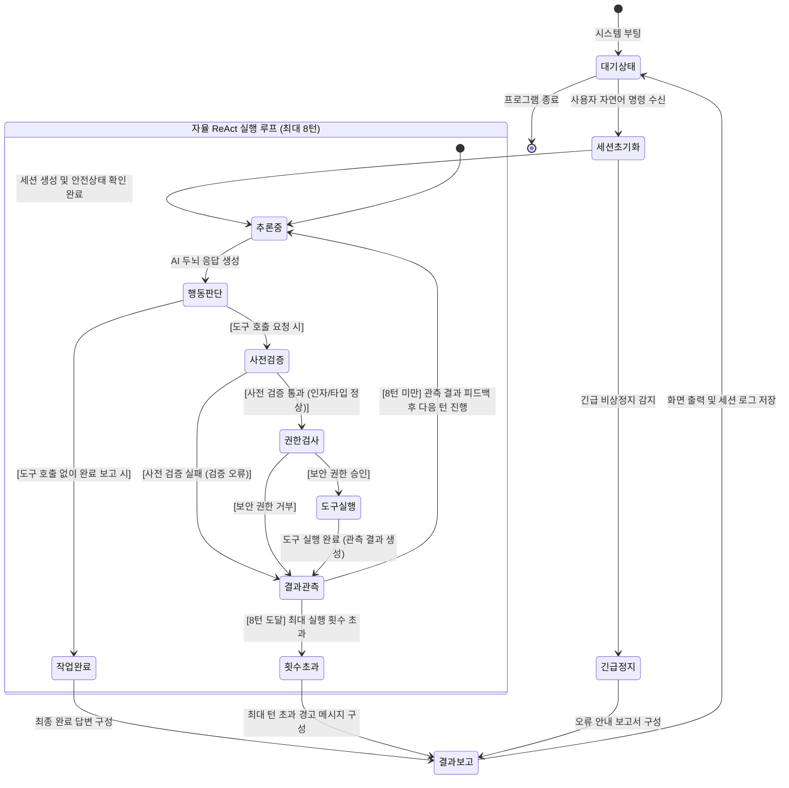

# 🤖 JARVIS (Just A Rather Very Intelligent System)

Windows 환경에서 로컬 제어, 시각 인식(Vision), 스마트 엑셀/파일 자동화 및 GUI 상호작용(RPA)을 수행하는 지능형 AI 어시스턴트 프로젝트입니다.

## 📄 기획 및 명세 문서
- [자비스 시스템 기획 및 요구사항 명세서 (PRD)](file:///c:/Users/majun/Coding/javis/docs/JARVIS_SPEC.md)

## 📁 주요 구성 요소 (예정)
- `jarvis/core/`: AI 두뇌(Gemini + Ollama 하이브리드), 안전 가드레일, 에이전트 루프
- `jarvis/tools/`: 화면 캡처/비전, 엑셀/파일 가공, Windows GUI 조작 도구
- `tests/`: TDD 기반 단위/통합 테스트



### 📋 주요 상태 정의

| 상태 | 설명 | 역할 및 진입 조건 |
| :--- | :--- | :--- |
| **대기 상태** | 기본 유휴 상태 | 사용자의 자연어 작업 지시를 기다리는 상태 |
| **세션 초기화** | 작업 준비 단계 | 개별 작업 세션 로그를 생성하고 비상 정지 상태를 점검하는 상태 |
| **추론 중** | AI 두뇌 사고 단계 | 사용 가능한 도구 목록을 바탕으로 LLM이 다음 행동 또는 답변을 추론하는 상태 |
| **행동 판단** | 분기 결정 단계 | 모델 출력을 분석하여 도구 호출이 필요한지, 작업이 완료되었는지 판별하는 상태 |
| **사전 검증** | 1차 인자 유효성 검증 | 필수 파라미터 누락, 알 수 없는 인자, 타입 불일치를 사전에 차단하는 상태 |
| **권한 검사** | 2차 보안 가드레일 | 위험 경로 접근, 미허가 파일 조작 등 보안 규칙 위반 여부를 검사하는 상태 |
| **도구 실행** | 실제 기능 수행 | 윈도우 OS 제어, 파일/엑셀 처리, 화면 캡처 및 문서 비전 분석을 실행하는 상태 |
| **결과 관측** | 피드백 수집 단계 | 도구 실행 결과나 에러 피드백을 대화 기록에 누적하고 현재 턴 수를 확인하는 상태 |
| **작업 완료 / 횟수 초과** | 루프 종결 | 작업 목표를 달성했거나 최대 허용 턴(8회)에 도달하여 루프를 빠져나오는 상태 |
| **결과 보고** | 최종 보고 및 저장 | 최종 작업 결과 카드를 화면에 표시하고 세션 로그를 파일로 저장한 뒤 대기 상태로 복귀 |


---

## 4. 사용자 인터페이스 및 상호작용 (UI/UX)
```json
{
  "path": "README.md"
}
```
- **Observation Result (Raw Full Content)**:
````text
# 🤖 JARVIS (Just A Rather Very Intelligent System)

Windows 환경에서 로컬 제어, 시각 인식(Vision), 스마트 엑셀/파일 자동화 및 GUI 상호작용(RPA)을 수행하는 지능형 AI 어시스턴트 프로젝트입니다.

## 📄 기획 및 명세 문서
- [자비스 시스템 기획 및 요구사항 명세서 (PRD)](file:///c:/Users/majun/Coding/javis/docs/JARVIS_SPEC.md)

## 📁 주요 구성 요소 (예정)
- `jarvis/core/`: AI 두뇌(Gemini + Ollama 하이브리드), 안전 가드레일, 에이전트 루프
- `jarvis/tools/`: 화면 캡처/비전, 엑셀/파일 가공, Windows GUI 조작 도구
- `tests/`: TDD 기반 단위/통합 테스트

```mermaid
stateDiagram-v2
    [*] --> 대기상태 : 시스템 부팅

    대기상태 --> 세션초기화 : 사용자 자연어 명령 수신
    
    세션초기화 --> 추론중 : 세션 생성 및 안전상태 확인 완료
    세션초기화 --> 긴급정지 : 긴급 비상정지 감지

    state "자율 ReAct 실행 루프 (최대 8턴)" as 자율루프 {
        추론중 --> 행동판단 : AI 두뇌 응답 생성
        
        state 행동판단 <<choice>>
        행동판단 --> 사전검증 : [도구 호출 요청 시]
        행동판단 --> 작업완료 : [도구 호출 없이 완료 보고 시]

        사전검증 --> 권한검사 : [사전 검증 통과 (인자/타입 정상)]
        사전검증 --> 결과관측 : [사전 검증 실패 (검증 오류)]

        권한검사 --> 도구실행 : [보안 권한 승인]
        권한검사 --> 결과관측 : [보안 권한 거부]

        도구실행 --> 결과관측 : 도구 실행 완료 (관측 결과 생성)

        state 결과관측 <<choice>>
        결과관측 --> 추론중 : [8턴 미만] 관측 결과 피드백 후 다음 턴 진행
        결과관측 --> 횟수초과 : [8턴 도달] 최대 실행 횟수 초과
    }

    작업완료 --> 결과보고 : 최종 완료 답변 구성
    횟수초과 --> 결과보고 : 최대 턴 초과 경고 메시지 구성
    긴급정지 --> 결과보고 : 오류 안내 보고서 구성

    결과보고 --> 대기상태 : 화면 출력 및 세션 로그 저장
    대기상태 --> [*] : 프로그램 종료
```

### 📋 주요 상태 정의

| 상태 | 설명 | 역할 및 진입 조건 |
| :--- | :--- | :--- |
| **대기 상태** | 기본 유휴 상태 | 사용자의 자연어 작업 지시를 기다리는 상태 |
| **세션 초기화** | 작업 준비 단계 | 개별 작업 세션 로그를 생성하고 비상 정지 상태를 점검하는 상태 |
| **추론 중** | AI 두뇌 사고 단계 | 사용 가능한 도구 목록을 바탕으로 LLM이 다음 행동 또는 답변을 추론하는 상태 |
| **행동 판단** | 분기 결정 단계 | 모델 출력을 분석하여 도구 호출이 필요한지, 작업이 완료되었는지 판별하는 상태 |
| **사전 검증** | 1차 인자 유효성 검증 | 필수 파라미터 누락, 알 수 없는 인자, 타입 불일치를 사전에 차단하는 상태 |
| **권한 검사** | 2차 보안 가드레일 | 위험 경로 접근, 미허가 파일 조작 등 보안 규칙 위반 여부를 검사하는 상태 |
| **도구 실행** | 실제 기능 수행 | 윈도우 OS 제어, 파일/엑셀 처리, 화면 캡처 및 문서 비전 분석을 실행하는 상태 |
| **결과 관측** | 피드백 수집 단계 | 도구 실행 결과나 에러 피드백을 대화 기록에 누적하고 현재 턴 수를 확인하는 상태 |
| **작업 완료 / 횟수 초과** | 루프 종결 | 작업 목표를 달성했거나 최대 허용 턴(8회)에 도달하여 루프를 빠져나오는 상태 |
| **결과 보고** | 최종 보고 및 저장 | 최종 작업 결과 카드를 화면에 표시하고 세션 로그를 파일로 저장한 뒤 대기 상태로 복귀 |


````


## 🔄 [Turn 3]
*Timestamp: 14:15:26*

### 📋 [주입된 작업 칠판 원문 (Injected Raw Blackboard)]
````text
📋 [JARVIS CURRENT WORKING BLACKBOARD]
- Phase: VERIFY
- Milestones:
  [1] 작업 대상 탐색 및 데이터 수집: DONE
  [2] 데이터 가공 및 도구 실행: DONE
  [3] 최종 결과 검증 및 완결 보고: PENDING
- Key Findings:
  read_file_관측: 성공 (# 🤖 JARVIS (Just A Rather Very Intelligent System)

Windows ...)
  read_file_observation: 성공 (# 🤖 JARVIS (Just A Rather Very Intelligent System)
Windows 환경에서 로컬 제어, 시각 인식(Vision), 스마트 엑셀/파일 자동화 및 GUI 상호작용(RPA)을 수행하는 지능형 AI 어시스턴트 프로젝트입니다.

## 📄 기획 및 명세 문서
- [자비스 시스템 기획 및 요구사항 명세서 (PRD)](file:///c:/Users/majun/Coding/javis/docs/JARVIS_SPEC.md)

## 📁 주요 구성 요소 (예정)
- `jarvis/core/`: AI 두뇌(Gemini + Ollama 하이브리드), 안전 가드레일, 에이전트 루프
- `jarvis/tools/`: 화면 캡처/비전, 엑셀/파일 가공, Windows GUI 조작 도구
- `tests/`: TDD 기반 단위/통합 테스트

```mermaid
stateDiagram-v2
    [*] --> 대기상태 : 시스템 부팅

    대기상태 --> 세션초기화 : 사용자 자연어 명령 수신

    세션초기화 --> 추론중 : 세션 생성 및 안전상태 확인 완료
    세션초기화 --> 긴급정지 : 긴급 비상정지 감지

    state "자율 ReAct 실행 루프 (최대 8턴)" as 자율루프 {
        추론중 --> 행동판단 : AI 두뇌 응답 생성

        state 행동판단 <<choice>>
        행동판단 --> 사전검증 : [도구 호출 요청 시]
        행동판단 --> 작업완료 : [도구 호출 없이 완료 보고 시]

        사전검증 --> 권한검사 : [사전 검증 통과 (인자/타입 정상)]
        사전검증 --> 결과관측 : [사전 검증 실패 (검증 오류)]

        권한검사 --> 도구실행 : [보안 권한 승인]
        권한검사 --> 결과관측 : [보안 권한 거부]

        도구실행 --> 결과관측 : 도구 실행 완료 (관측 결과 생성)

        state 결과관측 <<choice>>
        결과관측 --> 추론중 : [8턴 미만] 관측 결과 피드백 후 다음 턴 진행
        결과관측 --> 횟수초과 : [8턴 도달] 최대 실행 횟수 초과
    }

    작업완료 --> 결과보고 : 최종 완료 답변 구성
    횟수초과 --> 결과보고 : 최대 턴 초과 경고 메시지 구성
    긴급정지 --> 결과보고 : 오류 안내 보고서 구성

    결과보고 --> 대기상태 : 화면 출력 및 세션 로그 저장
    대기상태 --> [*] : 프로그램 종료
```

### 📋 주요 상태 정의

| 상태 | 설명 | 역할 및 진입 조건 |
| :--- | :--- | :--- |
| **대기 상태** | 기본 유휴 상태 | 사용자의 자연어 작업 지시를 기다리는 상태 |
| **세션 초기화** | 작업 준비 단계 | 개별 작업 세션 로그를 생성하고 비상 정지 상태를 점검하는 상태 |
| **추론 중** | AI 두뇌 사고 단계 | 사용 가능한 도구 목록을 바탕으로 LLM이 다음 행동 또는 답변을 추론하는 상태 |
| **행동 판단** | 분기 결정 단계 | 모델 출력을 분석하여 도구 호출이 필요한지, 작업이 완료되었는지 판별하는 상태 |
| **사전 검증** | 1차 인자 유효성 검증 | 필수 파라미터 누락, 알 수 없는 인자, 타입 불일치를 사전에 차단하는 상태 |
| **권한 검사** | 2차 보안 가드레일 | 위험 경로 접근, 미허가 파일 조작 등 보안 규칙 위반 여부를 검사하는 상태 |
| **도구 실행** | 실제 기능 수행 | 윈도우 OS 제어, 파일/엑셀 처리, 화면 캡처 및 문서 비전 분석을 실행하는 상태 |
| **결과 관측** | 피드백 수집 단계 | 도구 실행 결과나 에러 피드백을 대화 기록에 누적하고 현재 턴 수를 확인하는 상태 |
| **작업 완료 / 횟수 초과** | 루프 종결 | 작업 목표를 달성했거나 최대 허용 턴(8회)에 도달하여 루프를 빠져나오는 상태 |
| **결과 보고** | 최종 보고 및 저장 | 최종 작업 결과 카드를 화면에 표시하고 세션 로그를 파일로 저장한 뒤 대기 상태로 복귀 |
- [🚨 절대 금지 규칙 - Taboo List (절대 재시도 금지)]:
  - 🚫 Error executing read_file: FileNotFoundError - [파일을 찾을 수 없습니다: C:\Users\majun\Coding\javis\존재하지않는파일_8888.txt] (※ 이미 실패가 확정되었으므로 절대 다시 호출하지 말고 대안을 실행하십시오.)
````

> 💭 **AI 판단 (Thought)**: 존재하지 않는 파일 읽기 시도는 이미 실패한 것으로 보고 README.md 파일을 읽어 왔습니다.


---
## 🏁 [Task Final Completion]
- **Total Duration**: `41.11s`
- **Completion Time**: 2026-09-13 14:15:58
- **Final Report**:

존재하지 않는 파일 읽기 시도는 이미 실패한 것으로 보고 README.md 파일을 읽어 왔습니다.


        결과관측 --> 추론중 : [8턴 미만] 관측 결과 피드백 후 다음 턴 진행
        결과관측 --> 횟수초과 : [8턴 도달] 최대 실행 횟수 초과
    }

    작업완료 --> 결과보고 : 최종 완료 답변 구성
    횟수초과 --> 결과보고 : 최대 턴 초과 경고 메시지 구성
    긴급정지 --> 결과보고 : 오류 안내 보고서 구성

    결과보고 --> 대기상태 : 화면 출력 및 세션 로그 저장
    대기상태 --> [*] : 프로그램 종료
```

### 📋 주요 상태 정의

| 상태 | 설명 | 역할 및 진입 조건 |
| :--- | :--- | :--- |
| **대기 상태** | 기본 유휴 상태 | 사용자의 자연어 작업 지시를 기다리는 상태 |
| **세션 초기화** | 작업 준비 단계 | 개별 작업 세션 로그를 생성하고 비상 정지 상태를 점검하는 상태 |
| **추론 중** | AI 두뇌 사고 단계 | 사용 가능한 도구 목록을 바탕으로 LLM이 다음 행동 또는 답변을 추론하는 상태 |
| **행동 판단** | 분기 결정 단계 | 모델 출력을 분석하여 도구 호출이 필요한지, 작업이 완료되었는지 판별하는 상태 |
| **사전 검증** | 1차 인자 유효성 검증 | 필수 파라미터 누락, 알 수 없는 인자, 타입 불일치를 사전에 차단하는 상태 |
| **권한 검사** | 2차 보안 가드레일 | 위험 경로 접근, 미허가 파일 조작 등 보안 규칙 위반 여부를 검사하는 상태 |
| **도구 실행** | 실제 기능 수행 | 윈도우 OS 제어, 파일/엑셀 처리, 화면 캡처 및 문서 비전 분석을 실행하는 상태 |
| **결과 관측** | 피드백 수집 단계 | 도구 실행 결과나 에러 피드백을 대화 기록에 누적하고 현재 턴 수를 확인하는 상태 |
| **작업 완료 / 횟수 초과** | 루프 종결 | 작업 목표를 달성했거나 최대 허용 턴(8회)에 도달하여 루프를 빠져나오는 상태 |
| **결과 보고** | 최종 보고 및 저장 | 최종 작업 결과 카드를 화면에 표시하고 세션 로그를 파일로 저장한 뒤 대기 상태로 복귀 |


```

