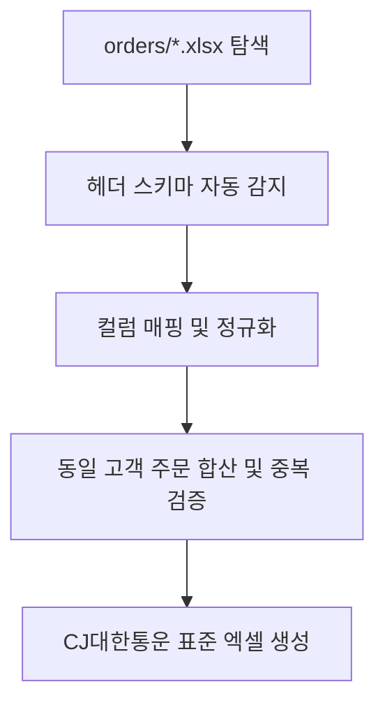

# 📦 [시나리오 1] 다채널 주문서 취합 및 택배사 송장 양식 자동 변환

> **도메인**: 이커머스 / 유통 / 물류  
> **상태**: 📐 아키텍처 설계 대기  
> **목표**: 제각각인 오픈마켓 주문 엑셀 파일들을 읽어 동일 수령인 병합 및 택배사 표준 송장 양식으로 1초 변환  

---

## 1. 🗣️ 사용자 요청 (User Prompt)
> *"orders 폴더에 있는 쿠팡, 스마트스토어, 지마켓 주문 엑셀 파일들을 읽어서, 서로 다른 컬럼명을 통일하고 동일 수령인의 중복 주문을 합친 다음 `outputs/CJ대한통운_송장양식.xlsx`로 일괄 변환해줘."*

---

## 2. 📥 입출력 규격 정의
* **입력 데이터 (Inputs)**:
  - `orders/*.xlsx` (플랫폼별 상이한 헤더: `받는사람` vs `수취인명`, `연락처` vs `전화번호1` 등)
* **출력 산출물 (Outputs)**:
  - `outputs/CJ대한통운_송장양식.xlsx` (규격: `받는분성명`, `전화번호`, `배송지주소`, `품목명`, `수량`, `배송메시지`)

---

## 3. 🛠️ 장착할 신규 도구 (Tools)
1. `transform_excel`: 컬럼 스키마 매핑 및 데이터 타입 변환
2. `merge_excel_sheets`: 다중 파일/시트 기준 키(성명+연락처) 기준 병합 및 중복 제거

---

## 4. 🏗️ 아키텍처 및 파이프라인 설계 (Draft)

### 세부 설계 체크리스트
- [ ] 플랫폼별 헤더 자동 감지 및 AI 기반 컬럼 매핑 룰 정의
- [ ] 전화번호 하이픈 통일 및 주소 정제 로직
- [ ] 합포장(동일 수령인/주소) 수량 합산 처리 정책
- [ ] Staging 격리 검증 및 롤백 가드레일
