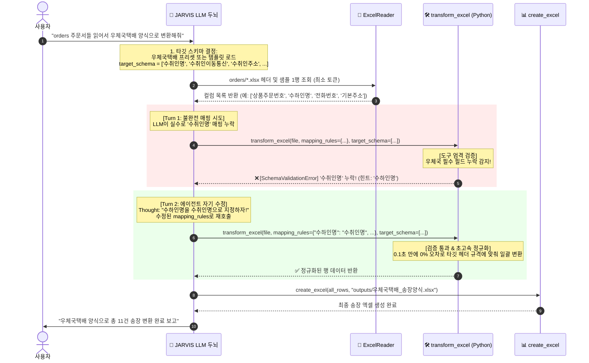
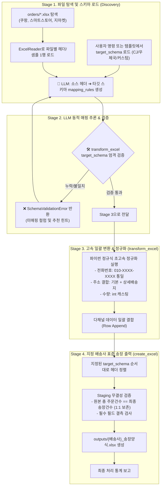

# 📦 [시나리오 1] 다채널 주문서 취합 및 범용 택배사 송장 변환 (Any-to-Any SaaS)

> **도메인**: 이커머스 / 유통 / 물류  
> **상태**: 🚀 범용 멀티 택배사 및 커스텀 템플릿 파이프라인 설계 완료 (구현 단계)  
> **개발 환경 가이드**: 
> - 💻 **현재(노트북)**: LLM/API 키 없이 로컬 오프라인 환경에서 도구 인터페이스 및 파이프라인 완전 구현 + TDD/Mock 테스트 검증
> - 🏠 **추후(홈 데스크톱)**: Ollama / 로컬 LLM 연동 후 에이전트 실전 자율 실행 테스트

---

## 1. 🗣️ 사용자 요청 (User Prompt 예시)

JARVIS는 고정된 특정 택배사뿐만 아니라 사용자가 지정하는 **어떤 택배사나 커스텀 엑셀 양식**으로도 유연하게 변환합니다:

> **[기본형 (CJ대한통운)]**:  
> *"orders 폴더에 있는 쿠팡, 스마트스토어, 지마켓 주문 엑셀 파일들을 읽어서, 서로 다른 컬럼명을 CJ대한통운 표준 양식에 맞게 통일하고 전화번호와 주소를 정제해서 `outputs/CJ대한통운_송장양식.xlsx`로 일괄 변환해줘."*

> **[우체국/한진/롯데/로젠 지정형]**:  
> *"orders 폴더 주문서들 읽어서 **우체국택배 송장 양식**으로 일괄 변환해줘."*

> **[사용자 자사 커스텀 템플릿 지정형]**:  
> *"우리 회사 템플릿(`templates/자사_송장_양식.xlsx`) 헤더에 맞춰서 orders 폴더 주문서들을 일괄 정리해줘."*

---

## 2. 🏛️ 국내 5대 택배사 표준 프리셋 및 커스텀 템플릿 지원 규격

국내 주요 택배사는 사용하는 전산 ERP가 제각각이므로 표준 헤더가 완전히 상이합니다. JARVIS는 **5대 택배사 표준 프리셋**과 **사용자 정의 커스텀 템플릿**을 모두 수용합니다.

| 택배사 | 전산 시스템 | 수령인 헤더 | 연락처 헤더 | 주소 헤더 | 품목 헤더 | 수량 헤더 | 배송메모 헤더 |
|:---|:---|:---:|:---:|:---:|:---:|:---:|:---:|
| **CJ대한통운** *(기본)* | eFLEXs / CNPlus | `받는분성명` | `전화번호1` | `배송지주소` | `품목명` | `수량` | `배송메시지` |
| **우체국택배** | 계약고객전용 | `수취인명` | `수취인이동통신` | `수취인주소` | `내용품명` | `수량` | `배달메시지` |
| **한진택배** | nFOCUS | `받는사람` | `받는분휴대폰` | `주소` | `상품명` | `수량` | `배송요청사항` |
| **롯데택배** | ALPS | `수하인명` | `수하인핸드폰` | `수하인주소` | `물품명` | `수량` | `전달메시지` |
| **로젠택배** | iLogis | `성명` | `핸드폰` | `배송지` | `품목` | `박스수량` | `요청사항` |
| **커스텀 템플릿** | 사용자 전용 엑셀 | 템플릿 엑셀 1행 헤더를 실시간 자동 추출하여 `target_schema`로 동적 주입 |

> [!NOTE]
> **주문 1:1 보존 원칙 (Market Compatibility)**  
> 오픈마켓 판매자 센터(쿠팡 윙, 스마트스토어 센터 등)는 **주문 1건당 송장번호 1개**를 매칭하여 대량 배송 처리를 합니다. 따라서 임의로 주문을 합치지 않고 **원본 주문 건수(Row)를 1:1로 100% 보존**하여 마켓 송장 역등록과의 완벽한 호환성을 보장합니다.

---

## 3. 💡 핵심 아키텍처: Any-to-Any 동적 스키마 브릿지 & ReAct 자기 수정 루프

> [!IMPORTANT]
> **기존 매크로/RPA 외주 프로그램 vs JARVIS AI 자동화 SaaS의 결정적 차이**
> - **기존 전통 매크로**: `받는분성명`, `전화번호1`로 코드가 하드코딩되어 있어, 택배사를 바꾸거나 엑셀 열 순서가 바뀌는 순간 에러를 내며 멈춤.
> - **JARVIS AI SaaS**: LLM이 **"입력 엑셀 헤더"**와 **"타깃 택배사 헤더(`target_schema`)"** 양쪽을 관측하고, 그 사이의 다리(`mapping_rules`)를 0초 만에 스스로 생성.



| 구분 | 담당 주체 | 역할 및 동작 방식 | 장점 |
|:---:|:---:|:---|:---|
| **타깃 스키마 결정** | **🤖 LLM / 설정** | 택배사 프리셋(CJ, 우체국, 한진 등) 또는 사용자 템플릿 엑셀에서 `target_schema` 자동 확보 | 어떤 택배사/커스텀 양식도 즉시 수용 |
| **동적 스키마 매핑** | **🤖 LLM** | 입력 엑셀 헤더와 타깃 스키마를 비교하여 `mapping_rules` 딕셔너리 동적 생성 | 토큰 50개 미만 소모, 하드코딩 의존 탈피 |
| **엄격 검증 (Gatekeeper)** | **🛠️ 도구 (`transform_excel`)** | 지정된 `target_schema`의 필수 필드 매핑 누락 시 구체적 에러 반환 | 임의 추측으로 인한 오배송 원천 차단 |
| **자기 수정 (Self-Correction)** | **🤖 LLM** | 도구의 검증 에러 피드백을 수신하고, Thought를 통해 매핑 규칙 교정 후 재시도 | 완전 자율형 ReAct 루프 동작 |
| **대량 데이터 고속 변환** | **🛠️ 도구 (`transform_excel`)** | 검증된 `mapping_rules`로 수천 행을 **파이썬 정규식으로 0.1초 만에 일괄 정규화 및 타깃 컬럼 정렬** | 환각 0%, 완벽한 하이픈/주소 포맷팅, 압도적 속도 |

---

## 4. 🏗️ 심플 4단계 실행 파이프라인



---

## 5. 🛠️ 핵심 도구 인터페이스 설계

### Tool 1: `transform_excel`
- **파일 위치**: `src/jarvis/tools/office.py` (엔진: `src/jarvis/office/excel_transformer.py`)
- **시그니처**:
  ```python
  def transform_excel(
      source_path: str | Path,
      mapping_rules: Dict[str, str],
      target_schema: Optional[List[str]] = None,
  ) -> List[Dict[str, Any]]:
  ```
- **호출 예시 (CJ대한통운 타깃)**:
  ```json
  {
    "name": "transform_excel",
    "args": {
      "source_path": "orders/쿠팡_주문내역_20260914.xlsx",
      "mapping_rules": {
        "받는사람": "받는분성명",
        "수하인전화번호": "전화번호1",
        "수하인주소": "배송지주소",
        "등록상품명": "품목명",
        "구매수량(개)": "수량",
        "배송메세지": "배송메시지"
      },
      "target_schema": ["받는분성명", "전화번호1", "배송지주소", "품목명", "수량", "배송메시지"]
    }
  }
  ```
- **호출 예시 (우체국택배 타깃)**:
  ```json
  {
    "name": "transform_excel",
    "args": {
      "source_path": "orders/쿠팡_주문내역_20260914.xlsx",
      "mapping_rules": {
        "받는사람": "수취인명",
        "수하인전화번호": "수취인이동통신",
        "수하인주소": "수취인주소",
        "등록상품명": "내용품명",
        "구매수량(개)": "수량",
        "배송메세지": "배달메시지"
      },
      "target_schema": ["수취인명", "수취인이동통신", "수취인주소", "내용품명", "수량", "배달메시지"]
    }
  }
  ```

### Tool 2: `create_excel` (기존 오피스 도구 활용)
- **파일 위치**: `src/jarvis/tools/office.py`
- 취합된 행 목록(`List[Dict[str, Any]]`)을 받아 정렬된 `target_schema` 헤더 스타일(폰트, 배경색, 열 너비 자동 맞춤)이 적용된 최종 `.xlsx` 파일 생성.

---

## 6. 🛡️ 가드레일 및 무결성 검증 (Guardrails)

1. **주문 1:1 건수 보존 검증 (Row Count Conservation)**:
   - 취합된 원본 주문 행 수의 총합 == 최종 생성된 송장의 행 수 (`assert sum(input_rows) == len(output_rows)`)
2. **결측치 방어 (Required Field Validation)**:
   - 수령인 성명, 배송지 주소, 전화번호가 결측된 불량 데이터가 있을 경우 에러 격리.
3. **Staging 격리 (Atomic Deployment)**:
   - 파일 쓰기 도중 중단되어 파일이 손상되는 것을 방지하기 위해 `.jarvis/staging/`에 임시 생성 후 완성본만 원자적 이동.

---

## 7. 🧪 TDD 및 검증 계획 (노트북 오프라인 환경)

- [x] **테스트 데이터 준비**: `orders/` 하위 쿠팡/스마트스토어/지마켓 3종 엑셀 준비 완료
- [ ] **단위 테스트 (Unit Tests)**:
  - `tests/unit/test_excel_transformer.py`:
    - CJ대한통운 타깃 스키마 매핑 및 검증 에러(누락 시) 테스트
    - 우체국택배 등 타 택배사 타깃 스키마 매핑 테스트 (범용성 검증)
    - 전화번호 정규화, 주소 결합, 수량 캐스팅 검증
- [ ] **파이프라인 통합 테스트 (Integration Test)**:
  - `tests/integration/test_scenario_1_order_aggregation.py`:
    - 3개 오픈마켓 파일 ➔ `transform_excel` ➔ `create_excel` 엔드투엔드 변환 및 1:1 건수 보존 검증 (Mock ReAct)
