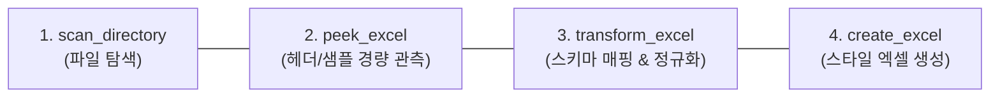
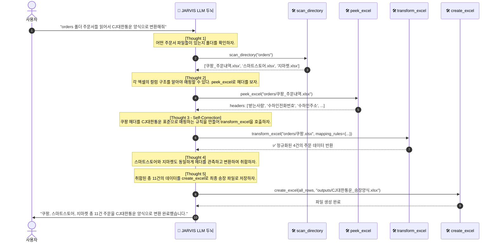

# 📦 [시나리오 1 벤치마크] 다채널 주문서 취합 및 범용 택배사 송장 변환

> **도메인**: 이커머스 / 유통 / 물류  
> **성격**: 🎯 **원자적 도구(Atomic Tools) 요구사항 정의 및 에이전트 자율성 평가 벤치마크**  
> **핵심 철학**: 본 문서는 사람이 고정된 파이프라인 코드를 짜기 위한 문서가 아닙니다. 범용 AI 에이전트가 이 실무 의뢰를 스스로 판단하고 해결할 수 있도록 **필요한 도구(Lego Blocks)의 사양을 도출하고, 자율 해결 여부를 검증하기 위한 벤치마크 테스트 규격**을 정의합니다.

---

## 1. 🗣️ 벤치마크 평가용 사용자 자연어 명령 (Benchmark Prompts)

JARVIS는 고정된 특정 택배사뿐만 아니라 사용자가 지정하는 **어떤 택배사나 커스텀 엑셀 양식**으로도 유연하게 변환합니다:

> **[기본형 (CJ대한통운)]**:  
> *"orders 폴더에 있는 쿠팡, 스마트스토어, 지마켓 주문 엑셀 파일들을 읽어서, 서로 다른 컬럼명을 CJ대한통운 표준 양식에 맞게 통일하고 전화번호와 주소를 정제해서 `outputs/CJ대한통운_송장양식.xlsx`로 일괄 변환해줘."*

> **[우체국/한진/롯데/로젠 지정형]**:  
> *"orders 폴더 주문서들 읽어서 **우체국택배 송장 양식**으로 일괄 변환해줘."*

> **[사용자 자사 커스텀 템플릿 지정형]**:  
> *"우리 회사 템플릿(`templates/자사_송장_양식.xlsx`) 헤더에 맞춰서 orders 폴더 주문서들을 일괄 정리해줘."*

---

## 2. 📥 입출력 스키마 규격 정의

### 1) 입력 데이터 (Inputs: `orders/*.xlsx`)
실제 오픈마켓 발주서의 이기종 헤더 스키마:

| 플랫폼 | 주요 입력 컬럼 (헤더) | 변환/정제 포인트 |
|:---|:---|:---|
| **쿠팡** | `받는사람`, `수하인전화번호`, `수하인주소`, `등록상품명`, `구매수량(개)`, `배송메세지` | `구매수량(개)` 정수 변환, 하이픈 없는 번호 정규화 |
| **스마트스토어** | `수취인명`, `연락처1`, `기본배송지`, `상세배송지`, `상품명`, `옵션정보`, `수량`, `배송메모` | `기본배송지` + `상세배송지` 결합, 옵션 포함 정규화 |
| **지마켓** | `성명`, `핸드폰`, `전화번호`, `주소`, `주문상품명`, `수량`, `배송요구사항` | 주소 공백/특수문자 정제, 전화번호 통일 |

### 2) 출력 산출물 (Outputs: 국내 5대 택배사 및 커스텀 규격)
CJ대한통운 B2B 표준 송장 양식 (6대 핵심 컬럼 예시):

| 순번 | 컬럼명 (타깃 헤더) | 타입 | 필수 여부 | 제약 조건 / 정규화 룰 |
|:---:|:---|:---:|:---:|:---|
| 1 | **받는분성명** | `string` | **필수** | 공백 제거 (Trim), 결측 시 배송 불가 |
| 2 | **전화번호** | `string` | **필수** | `010-XXXX-XXXX` 표준 하이픈 포맷 강제 |
| 3 | **배송지주소** | `string` | **필수** | 기본주소 + 상세주소 단일 결합, 다중 공백 단일화 |
| 4 | **품목명** | `string` | **필수** | 원본 상품명(옵션 포함) 유지 |
| 5 | **수량** | `int` | **필수** | 정수형 캐스팅 (`>= 1`) |
| 6 | **배송메시지** | `string` | 선택 | 결측 시 기본값 `""` 또는 `"부재시 문앞"` |

> [!NOTE]
> **주문 1:1 보존 원칙 (Market Compatibility)**  
> 오픈마켓 판매자 센터(쿠팡 윙, 스마트스토어 센터 등)는 **주문 1건당 송장번호 1개**를 매칭하여 대량 배송 처리를 합니다. 따라서 임의로 주문을 합치지 않고 **원본 주문 건수(Row)를 1:1로 100% 보존**하여 마켓 송장 역등록과의 완벽한 호환성을 보장합니다.

---

## 3. 🛠️ 에이전트 도구 벨트에 장착할 원자적 도구(Atomic Tools) 명세

본 시나리오를 해결하기 위해 에이전트가 쥐고 있어야 할 **4가지 독립적이고 직교적인 원자적 도구**입니다:

### 1) `scan_directory` (탐색 도구 - 기존 보유)
- **역할**: 지정된 디렉터리(`orders/`) 내의 파일 목록과 확장자를 인덱싱하여 에이전트에게 전달.

### 2) `peek_excel` (스키마 관측 도구 - **신규 핵심**)
- **필요성**: `.xlsx`는 바이너리 파일이므로 일반 `read_file`로 읽을 수 없고, 전체를 다 읽으면 토큰이 폭발합니다.
- **시그니처**: `peek_excel(file_path: str | Path, sheet_name: Optional[str] = None, row_limit: int = 2) -> Dict[str, Any]`
- **반환값**: 시트명 목록, 컬럼 헤더 목록, 상위 1~2개 샘플 행 (토큰 소모량 50개 미만 보장).

### 3) `transform_excel` (동적 변환 & 정규화 도구 - **신규 핵심**)
- **필요성**: LLM이 추론한 `mapping_rules`를 기반으로 수천 행의 데이터를 0.1초 만에 일괄 변환 및 정규화.
- **시그니처**: `transform_excel(source_path: str | Path, mapping_rules: Dict[str, str], target_schema: Optional[List[str]] = None) -> List[Dict[str, Any]]`
- **핵심 기능**:
  - **엄격한 스키마 검증**: 필수 필드 누락 시 `SchemaValidationError`를 발생시켜 LLM이 스스로 교정(Self-Correction)하도록 피드백.
  - **고속 필드 정규화**: `010-XXXX-XXXX` 전화번호 표준화, 기본+상세 배송지 결합, 수량 int 변환.

### 4) `create_excel` (출력 도구 - 기존 보유)
- **역할**: 취합된 정규화 행 목록(`List[Dict[str, Any]]`)을 받아 지정된 택배사 스타일의 정식 엑셀 파일 생성.

---

## 4. 🧠 에이전트 자율 해결 기대 궤적 (Expected ReAct Trajectory)

에이전트 두뇌는 사람이 짠 고정 코드가 아니라, 아래와 같은 **자율적인 사고(Thought)와 행동(Action) 루프**를 거쳐 문제를 해결합니다:

---

## 5. 🎯 벤치마크 평가 기준 (Evaluation Benchmark Criteria)

에이전트가 본 시나리오를 자율적으로 성공했는지 검증하는 정량적 평가 척도입니다:

1. **자율 탐색 및 스키마 관측 성공률 (100%)**:
   - 에이전트가 사람이 파일명을 알려주지 않아도 `scan_directory`와 `peek_excel`을 스스로 호출하여 헤더를 파악하는가?
2. **주문 1:1 건수 보존 (100% Match)**:
   - 원본 주문 건수(총 11건)와 최종 생성된 송장의 건수(11건)가 정확히 일치하는가? (`assert len(inputs) == len(outputs)`)
3. **전화번호 하이픈 정규화율 (100%)**:
   - 점 표기(`010.5555.6666`)나 하이픈 없는 번호(`01077778888`)가 빠짐없이 `010-XXXX-XXXX`로 표준화되었는가?
4. **분리 주소 결합 완결성 (100%)**:
   - 스마트스토어의 `기본배송지`와 `상세배송지`가 공백으로 매끄럽게 연결되었는가?
5. **ReAct 자기 수정(Self-Correction) 회복력**:
   - 매핑 누락 에러 발생 시 포기하지 않고 다음 턴에서 올바른 매핑으로 재시도하여 성공하는가?
