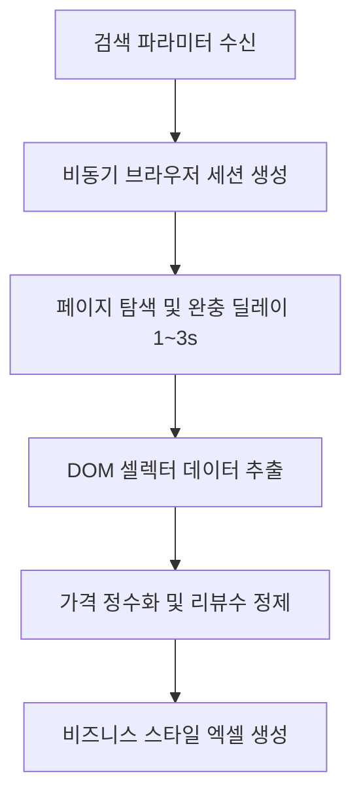

# 🌐 [시나리오 2] 웹 상품 가격·리뷰 데이터 수집 및 경쟁사 모니터링

> **도메인**: 웹 크롤링 / 마케팅 / 이커머스 모니터링  
> **상태**: 📐 아키텍처 설계 대기  
> **목표**: 오픈마켓 및 포털에서 타깃 상품의 실시간 가격, 재고, 리뷰 데이터를 법적 가드레일을 준수하며 자동 스크랩  

---

## 1. 🗣️ 사용자 요청 (User Prompt)
> *"네이버 쇼핑에서 '캠핑의자'로 검색해서 1페이지부터 3페이지까지의 상품명, 실시간 판매가, 스토어명, 리뷰 수, 평점을 스크랩한 뒤 `outputs/캠핑의자_경쟁사가격.xlsx`에 저장해줘."*

---

## 2. 📥 입출력 규격 정의
* **입력 데이터 (Inputs)**:
  - 타깃 URL / 검색어, 수집 페이지 범위 (1~3), 추출 희망 필드 목록
* **출력 산출물 (Outputs)**:
  - `outputs/캠핑의자_경쟁사가격.xlsx` (순위, 상품명, 할인가, 몰이름, 리뷰수, 별점)

---

## 3. 🛠️ 장착할 신규 도구 (Tools)
1. `scrape_web`: Playwright 기반 비동기 DOM 파싱 및 텍스트 추출 도구
2. 🛡️ **법적 보호 가드레일**:
   - 1~3초 무작위 지연(Random Delay) 강제 적용 (업무방해죄 방지)
   - User-Agent 로테이션 및 공개 데이터 범위 한정

---

## 4. 🏗️ 아키텍처 및 파이프라인 설계 (Draft)

### 세부 설계 체크리스트
- [ ] Playwright 브라우저 리소스 경량화 및 Headless 설정
- [ ] CSS 셀렉터 변경 시 Fallback(대안 추출) 로직 설계
- [ ] 서버 부하 방지를 위한 최대 수집 건수 제한(Max items: 50~100)
- [ ] 안티 캡차 우회 배제 및 적법성 준수 규칙
