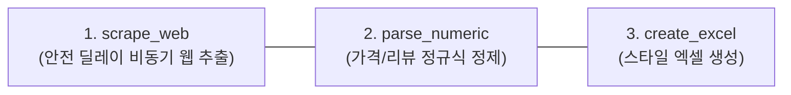
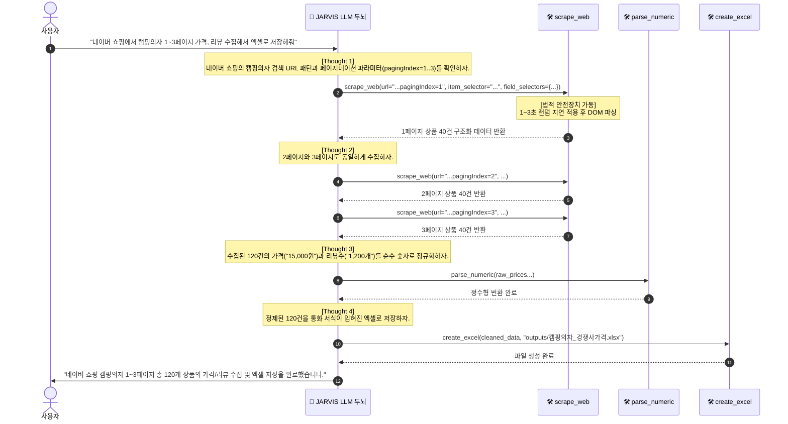

# 🌐 [시나리오 2 벤치마크] 웹 상품 가격·리뷰 데이터 수집 및 경쟁사 모니터링

> **도메인**: 웹 크롤링 / 마케팅 / 이커머스 모니터링  
> **성격**: 🎯 **원자적 도구(Atomic Tools) 요구사항 정의 및 에이전트 자율성 평가 벤치마크**  
> **핵심 철학**: 본 문서는 네이버 쇼핑 전용의 고정된 크롤러 스크립트를 짜기 위한 문서가 아닙니다. 범용 AI 에이전트가 어떤 웹사이트의 데이터 수집 의뢰를 받더라도 법적 규제를 준수하며 자율적으로 탐색·수집·정제할 수 있도록 **필요한 원자적 도구(Atomic Tools)의 사양을 도출하고, 자율 해결 능력을 검증하기 위한 벤치마크 규격**을 정의합니다.

---

## 1. 🗣️ 벤치마크 평가용 사용자 자연어 명령 (Benchmark Prompts)

JARVIS는 단일 사이트 하드코딩이 아닌, 다양한 이커머스 및 포털 사이트의 가격/리뷰 수집 요청을 유연하게 해결합니다:

> **[기본형 (포털 쇼핑 검색 결과 수집)]**:  
> *"네이버 쇼핑에서 '캠핑의자'로 검색해서 1페이지부터 3페이지까지의 상품명, 실시간 판매가, 스토어명, 리뷰 수, 평점을 스크랩한 뒤 `outputs/캠핑의자_경쟁사가격.xlsx`에 저장해줘."*

> **[가격 비교 / 특정 플랫폼 지정형]**:  
> *"다나와 또는 쿠팡에서 '게이밍 모니터 27인치' 인기 상품 상위 20개의 최저가, 판매처, 스펙 정보를 수집해서 엑셀로 정리해줘."*

> **[특정 경쟁사 스토어 모니터링형]**:  
> *"해당 스마트스토어 URL(`https://smartstore.naver.com/...`)에 등록된 전체 상품 목록의 상품명, 할인가, 품절 여부를 확인해서 리포트로 뽑아줘."*

---

## 2. 📥 입출력 스키마 규격 정의

### 1) 입력 데이터 및 지시 조건 (Inputs)
* **타깃 사이트 및 검색어**: 검색 키워드(예: `캠핑의자`) 또는 타깃 URL
* **수집 범위**: 페이지 수(1~3페이지) 또는 최대 수집 건수(Max items: 50~100건)
* **추출 희망 속성**: 상품명, 판매가격, 쇼핑몰명, 리뷰수, 평점, 상품상세링크

### 2) 출력 산출물 (Outputs: `outputs/캠핑의자_경쟁사가격.xlsx`)
비즈니스 표준 경쟁사 가격 조사표 (6대 핵심 컬럼):

| 순번 | 컬럼명 | 타입 | 필수 여부 | 데이터 정규화 및 포맷 룰 |
|:---:|:---|:---:|:---:|:---|
| 1 | **순위** | `int` | **필수** | 1부터 시작하는 순차 정수 (`1, 2, 3...`) |
| 2 | **상품명** | `string` | **필수** | 특수문자 정제 및 앞뒤 공백 제거 (Trim) |
| 3 | **판매가격** | `int` | **필수** | 통화 기호(`₩`), 콤마(`,`), `"원"` 제거 후 순수 정수화 (예: `15800`) |
| 4 | **스토어명** | `string` | **필수** | 판매처 상호명 (예: `네이버 공식몰`, `캠핑월드`) |
| 5 | **리뷰수** | `int` | 선택 | `"리뷰 1,234개"` ➔ 순수 정수 `1234` 변환 (없을 시 `0`) |
| 6 | **평점** | `float` | 선택 | `"★ 4.8"`, `"4.8/5"` ➔ 실수 `4.8` 변환 (없을 시 `0.0`) |
| 7 | **상품URL** | `string` | 선택 | 유효한 상품 상세페이지 하이퍼링크 URL |

---

## 3. 💡 핵심 아키텍처: 법적 가드레일 & 대량 HTML 토큰 격리

> [!IMPORTANT]
> **웹 크롤링 에이전트의 2대 치명적 리스크와 해결책**

### 1) 법적 안전 가드레일 준수 (대법원 판례 및 정보통신망법)
무분별한 웹 스크래핑은 **업무방해죄(형법 제314조)** 및 **정보통신망법 위반**으로 법적 분쟁을 초래할 수 있습니다. 에이전트 도구는 이를 원천 차단하는 안전장치를 내장합니다:
- **무작위 완충 딜레이 (Random Delay 1~3초 강제)**: 페이지 요청 간 1~3초의 무작위 인터벌을 강제 적용하여 대상 서버에 부하(DDoS성 부하)를 주지 않습니다.
- **비로그인 공개 데이터 한정**: 로그인 우회, CAPTCHA 무력화, 세션 탈취 행위를 배제하고, 일반 사용자에게 공개된 사실 정보(상품명, 가격 등)만 수집합니다.
- **수집 상한선 (Throttling Cap)**: 1회 요청당 최대 수집 건수를 제한(기본 50~100건)하여 과도한 트래픽 유발을 방지합니다.

### 2) 대량 HTML 토큰 격리 (Token Isolation)
- 2~3페이지 분량의 렌더링된 HTML 전체를 LLM에게 넘기면 **수십만 토큰이 소모되어 컨텍스트 초과 및 비용 폭발**이 일어납니다.
- **해결책**: 도구(`scrape_web`) 내부에서 Playwright/BeautifulSoup을 활용해 필요한 요소(상품 카드)만 파싱하여 **구조화된 경량 JSON 리스트**로 변환한 뒤 LLM에게는 요약/관측 메타데이터만 전달합니다.

---

## 4. 🛠️ 에이전트 도구 벨트에 장착할 원자적 도구(Atomic Tools) 명세

본 시나리오를 해결하기 위해 에이전트가 쥐고 있어야 할 **독립적이고 직교적인 원자적 도구**입니다:



### 1) `scrape_web` (웹 데이터 안전 수집 도구 - **신규 핵심**)
- **필요성**: SPA(React/Next.js) 기반의 동적 렌더링 사이트에서도 브라우저 세션을 통해 정확하게 상품 요소를 수집.
- **시그니처**:
  ```python
  def scrape_web(
      url: str,
      item_selector: str,
      field_selectors: Dict[str, str],
      max_items: int = 50,
      random_delay: bool = True,
  ) -> List[Dict[str, Any]]:
  ```
- **주요 기능**:
  - Headless Chromium 브라우저를 통한 동적 DOM 렌더링 대기 (`networkidle` 또는 셀렉터 대기).
  - 요청 간 `1.0 ~ 3.0초`의 무작위 대기 시간 자동 적용.
  - `field_selectors`에 정의된 CSS/XPath 규칙에 따라 텍스트 및 속성값(`href`) 일괄 추출.

### 2) `parse_numeric` (숫자/통화 정규화 도구 - **보조 유틸**)
- **필요성**: `"15,800원"`, `"리뷰 999+"`, `"평점 4.9/5"` 등 비정형 텍스트를 연산/정렬 가능한 순수 숫자(`int`, `float`)로 정규화.
- **시그니처**: `parse_numeric(text: str, target_type: str = "int") -> Union[int, float, None]`

### 3) `create_excel` (출력 도구 - 기존 보유)
- **역할**: 수집된 데이터 리스트를 천단위 콤마 서식, 링크 하이퍼링크, 헤더 스타일이 적용된 `.xlsx` 파일로 저장.

---

## 5. 🧠 에이전트 자율 해결 기대 궤적 (Expected ReAct Trajectory)

에이전트는 하드코딩된 스크립트 없이, 아래와 같은 **자율적인 사고(Thought)와 행동(Action) 루프**를 거쳐 문제를 해결합니다:



---

## 6. 🎯 벤치마크 평가 기준 (Evaluation Benchmark Criteria)

에이전트가 본 시나리오를 자율적으로 성공했는지 검증하는 정량적 평가 척도입니다:

1. **페이지네이션 자율 인식 및 연속 수집 성공률 (100%)**:
   - 에이전트가 1페이지만 긁고 끝내지 않고, 지시된 3페이지까지 URL 파라미터를 자율 갱신하며 수집해 내는가?
2. **법적 가드레일 (완충 지연) 준수 여부**:
   - 페이지 요청 간 최소 1초 이상의 지연 시간이 보장되어 대상 서버에 무리를 주지 않는가?
3. **가격/리뷰 데이터 순수 숫자 정제율 (100%)**:
   - 엑셀의 `판매가격` 컬럼이 문자열(`"15,000원"`)이 아닌 실제 엑셀 계산이 가능한 숫자형(`15000`)으로 정제되었는가?
4. **결측치 및 광고 상품 방어력 (Robustness)**:
   - 리뷰가 없거나 평점이 없는 신규 상품, 또는 중간 광고 배너 항목이 섞여 있어도 파싱 에러(Crash) 없이 유연하게 기본값(`0`)으로 처리하는가?
5. **엑셀 서식 가독성**:
   - 가격 컬럼에 천단위 콤마 서식(`#,##0`)이 적용되고, 긴 상품명이 잘리지 않도록 열 너비가 자동 조정되었는가?
