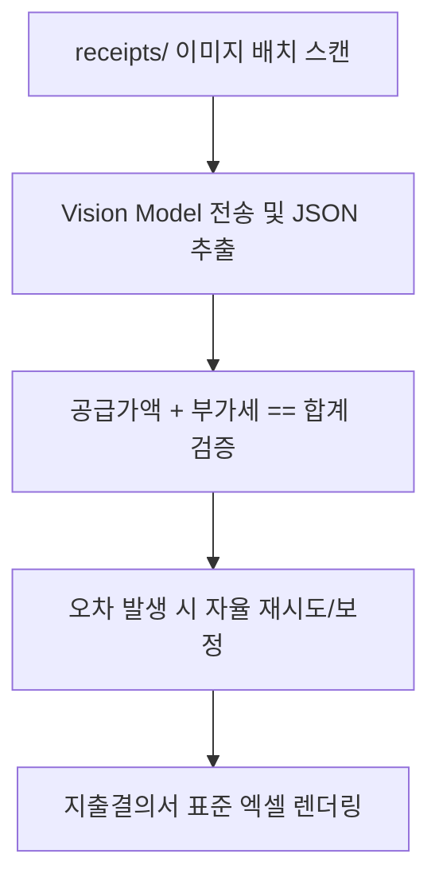

# 🧾 [시나리오 3] 영수증·인보이스 시각 자동 분석 및 지출결의서 집계

> **도메인**: 회계 / 세무 / 비전 OCR / 정산 자동화  
> **상태**: 📐 아키텍처 설계 대기  
> **목표**: 스마트폰 촬영 영수증 이미지들에서 비전 LLM으로 주요 키값을 추출하고 공급가액/부가세 합산 엑셀 생성  

---

## 1. 🗣️ 사용자 요청 (User Prompt)
> *"receipts 폴더에 있는 영수증/카드전표 사진들을 전부 읽어서, 거래일자, 상호명, 사업자번호, 품목, 공급가액, 부가세를 추출하고 `outputs/9월_지출결의서.xlsx`로 일괄 합산 정리해줘."*

---

## 2. 📥 입출력 규격 정의
* **입력 데이터 (Inputs)**:
  - `receipts/*.{jpg,png,pdf}` (다양한 각도, 해상도의 영수증 사진들)
* **출력 산출물 (Outputs)**:
  - `outputs/9월_지출결의서.xlsx` (일자, 상호, 사업자번호, 공급가액, 세액, 합계 + 수식 계산행)

---

## 3. 🛠️ 장착할 신규 도구 (Tools)
1. `analyze_document`: Gemini 2.5 Flash / Ollava Llava 기반 Vision OCR 구조화 파서
2. `create_excel`: 비즈니스 테마 및 SUM 수식 서식이 적용된 지출결의서 렌더러

---

## 4. 🏗️ 아키텍처 및 파이프라인 설계 (Draft)

### 세부 설계 체크리스트
- [ ] 영수증 정형 JSON 스키마 (date, vendor, amount, vat, total) 정의
- [ ] 수학적 검증기(Math Validator: 공급가액+세액==합계) 및 오차 보정 로직
- [ ] 로컬 8GB VRAM (Llava) vs 클라우드 (Gemini Flash) 하이브리드 Fallback 구조
- [ ] 0바이트 파일 및 비정상 이미지 Evaluator 거부 정책
