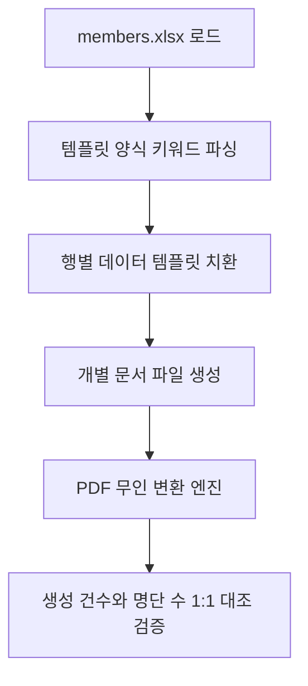

# 📄 [시나리오 4] 엑셀 명단 기반 계약서·위촉장 대량 렌더링 및 PDF 일괄 변환

> **도메인**: 공공 행정 / 법무 / 오피스 문서 자동화  
> **상태**: 📐 아키텍처 설계 대기  
> **목표**: 엑셀 명단의 수백 명 인적 사항을 Word/HWP 템플릿에 고속 치환 후 개인별 PDF 일괄 컴파일  

---

## 1. 🗣️ 사용자 요청 (User Prompt)
> *"members.xlsx 명단에 있는 이름, 소속, 직책, 생년월일을 읽어서 `template_위촉장.docx` 양식의 플레이스홀더에 각각 치환해 넣고, `outputs/certificates/` 폴더에 개인별 PDF 파일로 대량 일괄 생성해줘."*

---

## 2. 📥 입출력 규격 정의
* **입력 데이터 (Inputs)**:
  - `members.xlsx` (대상자 명단 테이블)
  - `template_위촉장.docx` (치환 키워드: `{{성명}}`, `{{소속}}`, `{{직책}}` 등)
* **출력 산출물 (Outputs)**:
  - `outputs/certificates/위촉장_홍길동.pdf`, `outputs/certificates/위촉장_김철수.pdf` 등 개별 파일

---

## 3. 🛠️ 장착할 신규 도구 (Tools)
1. `render_document_template`: `python-docx` / `hwpx` 기반 텍스트/표 변수 치환기
2. `convert_to_pdf`: Word/HWP 문서를 무인 백그라운드 PDF로 컴파일하는 변환기

---

## 4. 🏗️ 아키텍처 및 파이프라인 설계 (Draft)

### 세부 설계 체크리스트
- [ ] 플레이스홀더(`{{key}}`) 매핑 엔진 및 누락 필드 예외 처리
- [ ] Windows OLE/ActiveX COM 인터페이스 (`win32com`) 안전 해제 보장
- [ ] 대량 생성 시 메모리 누수 방지 및 배치 프로세싱 분할
- [ ] 파일명 특수문자 정제(Sanitization) 로직
