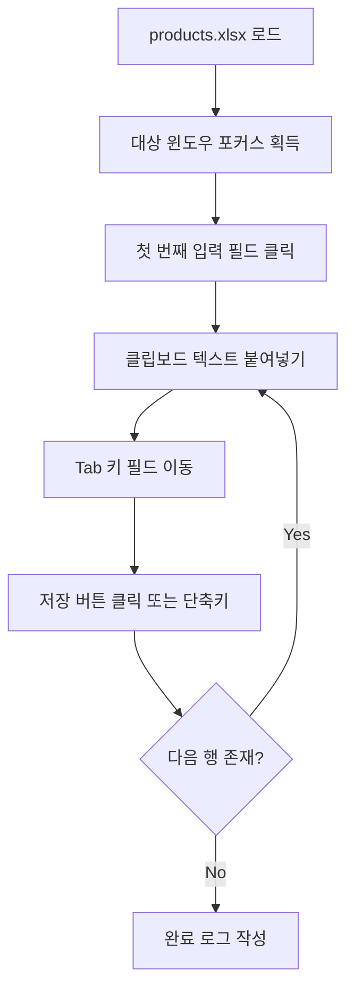

# 🖱️ [시나리오 5] 엑셀 데이터 기반 사내 ERP 및 웹 폼 연속 자동 입력

> **도메인**: 데스크톱 RPA / GUI 자동화 / 폼 시퀀서  
> **상태**: 📐 아키텍처 설계 대기  
> **목표**: 엑셀 목록 데이터를 읽어 화면의 특정 전산 프로그램 입력창에 Tab 키로 이동하며 한글 깨짐 없이 고속 자동 타이핑 및 저장  

---

## 1. 🗣️ 사용자 요청 (User Prompt)
> *"products.xlsx에 있는 신상품 50개 목록을 읽어서, 화면에 열려 있는 쇼핑몰 관리자 페이지의 상품명, 판매가, 재고수량 입력 필드에 Tab 키로 이동하며 순서대로 자동 타이핑하고 저장 버튼을 눌러줘."*

---

## 2. 📥 입출력 규격 정의
* **입력 데이터 (Inputs)**:
  - `products.xlsx` (등록할 상품 데이터 50행)
  - 대상 전산 프로그램 또는 웹 브라우저 활성 창
* **출력 산출물 (Outputs)**:
  - 전산 등록 결과 실행 로그 및 성공/실패 통계 리포트

---

## 3. 🛠️ 장착할 신규 도구 (Tools)
1. `desktop_type_text`: 클립보드 기반 한글 IME 안전 타이핑기
2. `desktop_press_hotkey`: `Tab`, `Enter`, `Ctrl+S` 등 시퀀스 단축키 전송기
3. `desktop_click`: 특정 화면 좌표 또는 시각 앵커 클릭기
4. 🛡️ **안전 킬스위치**: 마우스 화면 모서리 이동 긴급 탈출 및 `Ctrl+Alt+S` 글로벌 핫키 정지

---

## 4. 🏗️ 아키텍처 및 파이프라인 설계 (Draft)

### 세부 설계 체크리스트
- [ ] PyAutoGUI FailSafe 활성화 (`pyautogui.FAILSAFE = True`)
- [ ] 한글 조합 깨짐 방지: `pyperclip.copy()` + `Ctrl+V` 메커니즘 검증
- [ ] 입력 필드 간 안전 딜레이(`Action Delay: 0.1~0.3s`) 설정
- [ ] 백그라운드 킬스위치 스레드 연동
