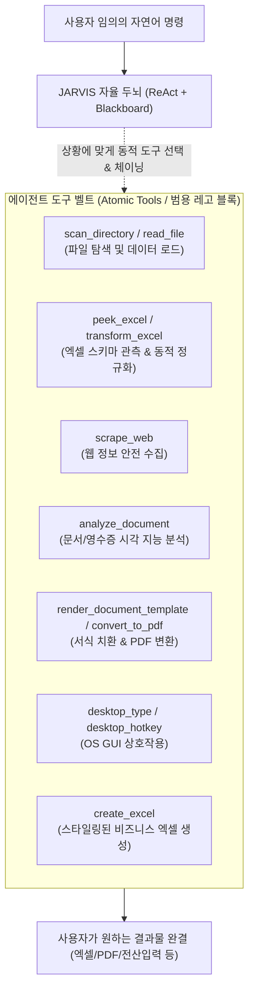

# 🚀 외주 기반 5대 핵심 자동화 시나리오 및 원자적 도구(Atomic Tools) 요구사항 명세서

> **문서 버전**: v2.0.0 (범용 에이전트 아키텍처 반영)  
> **기준 시장**: 크몽·숨고 업무 자동화 카테고리 고빈도 발주 데이터  
> **본 문서의 핵심 목적**:  
> 본 문서는 **특정 시나리오에 종속된 고정 파이프라인(Fixed Pipeline / Hardcoded DAG)을 설계하는 문서가 아닙니다.**  
> JARVIS는 단발성 외주 매크로 프로그램이 아니라, 사용자의 다양한 자연어 명령을 스스로 해석하여 런타임에 자율 계획(Dynamic Planning & ReAct)을 수립하는 **"범용 자율 AI 사무 에이전트(General-Purpose Autonomous AI Agent)"**입니다.  
> 
> 따라서 본 문서의 목적은:  
> 1. 실제 외주 발주량이 가장 집중되는 5대 고난도 실무 상황을 분석하여, 에이전트가 어떤 상황에서도 조합하여 사용할 수 있는 **직교적이고 재사용 가능한 '원자적 도구(Atomic Tools / Lego Blocks)'의 명세를 정밀하게 도출**하고,  
> 2. 개발된 도구들을 도구 레지스트리(Tool Belt)에 장착한 뒤, 에이전트가 사람의 하드코딩 개입 없이 **오직 자연어 명령만으로 스스로 문제를 해결하는지 검증하기 위한 '에이전트 자율성 평가 벤치마크(Evaluation Benchmark)'**를 정의하는 것입니다.

---

## 📌 1. 철학: 고정 파이프라인(Pipeline) vs 범용 자율 에이전트(Autonomous Agent)

| 구분 | 레거시 워크플로우 / 전통적 매크로 (Pipeline) | JARVIS 범용 자율 에이전트 (Autonomous Agent) |
|:---|:---|:---|
| **실행 방식** | 사람이 정해둔 1단계 ➔ 2단계 ➔ 3단계 고정 코드 실행 | LLM 두뇌가 사용자의 프롬프트를 보고 **런타임에 동적으로 계획 수립** |
| **변화 적응력** | 사용자가 조금만 다르게 말하거나 양식이 바뀌면 즉시 실패 | 프롬프트 변화에 맞춰 도구 호출 순서와 인자를 **자율적으로 재조립** |
| **개발자의 역할** | 특정 시나리오 전용 엔드투엔드 파이프라인 코딩 | 에이전트가 자유롭게 꺼내 쓸 수 있는 **완성도 높은 원자적 도구(Atomic Tools) 제작** |
| **시나리오의 의미** | 개발할 시스템의 고정 파이프라인 설계도 | 에이전트의 도구 벨트를 채우기 위한 **요구사항 분석서이자 벤치마크 테스트셋** |

---

## 📋 2. 5대 핵심 실무 시나리오 및 원자적 도구(Atomic Tools) 요구사항

---

### 📦 시나리오 1. 다채널 주문서 취합 및 범용 택배사 송장 변환 (이커머스/물류)
* **시장 수요**: 외주 의뢰 비중 **30%** (단일 서비스 최다 발주 분야)
* **해결 과제**: 쿠팡, 스마트스토어, 지마켓 등 플랫폼마다 제각각인 엑셀 컬럼을 CJ대한통운, 우체국, 롯데 등 지정 택배사나 자사 양식으로 1초 변환.
* **상세 벤치마크 문서**: [`docs/scenarios/01_다채널_주문서_취합_및_송장_변환/01_다채널_주문서_취합_및_송장_변환.md`](./01_다채널_주문서_취합_및_송장_변환/01_다채널_주문서_취합_및_송장_변환.md)

#### 1) 벤치마크 평가용 사용자 자연어 지시문 (Benchmark Prompt)
> *"orders 폴더에 있는 쿠팡, 스마트스토어, 지마켓 주문 엑셀 파일들을 읽어서, 서로 다른 컬럼명을 CJ대한통운 표준 양식에 맞게 통일하고 전화번호와 주소를 정제해서 `outputs/CJ대한통운_송장양식.xlsx`로 일괄 변환해줘."*

#### 2) 입출력 데이터 명세
* **입력 (Inputs)**: `orders/*.xlsx` (플랫폼별 상이한 헤더: `받는사람`, `수취인명`, `성명` 등)
* **출력 (Outputs)**: `outputs/CJ대한통운_송장양식.xlsx` (규격: `받는분성명`, `전화번호`, `배송지주소`, `품목명`, `수량`, `배송메시지`)

#### 3) 에이전트에게 필요한 원자적 도구 요구사항 (Required Atomic Tools)
| 원자적 도구명 | 파라미터 (Schema) | 도구의 범용적 역할 및 필요성 |
|:---|:---|:---|
| `scan_directory` | `path: str, recursive: bool` | 폴더 내 임의의 주문 파일 목록을 에이전트가 스스로 탐색 |
| `peek_excel` | `file_path: str, row_limit: int = 2` | **[필수]** 토큰 폭발 없이 엑셀의 컬럼 헤더와 1행 샘플만 가볍게 관측 |
| `transform_excel` | `source_path: str, mapping_rules: dict, target_schema: list` | LLM이 지시한 매핑 룰대로 컬럼 리네이밍, 전화번호 하이픈, 주소 결합 고속 정규화 |
| `create_excel` | `data: list[dict], output_path: str` | 정제된 데이터를 최종 택배사 스타일의 엑셀로 출력 |

#### 4) 에이전트 자율 수행 평가 기준 (Evaluation Criteria)
- [ ] 에이전트가 `scan_directory`로 `orders/` 내의 파일 목록을 스스로 찾아내는가?
- [ ] `peek_excel`로 각 파일의 헤더를 확인하고, 정확한 `mapping_rules`를 스스로 추론하는가?
- [ ] 오픈마켓 대량 송장 역등록 호환을 위해 주문 1:1 건수 보존(`len(inputs) == len(outputs)`)을 달성하는가?

---

### 🌐 시나리오 2. 웹 상품 가격·리뷰 경쟁사 데이터 수집 및 모니터링 (크롤링/마케팅)
* **시장 수요**: 외주 의뢰 비중 **30%**
* **해결 과제**: 매일 아침 눈으로 포털을 확인하던 수작업을 자동화하여 실시간 최저가, 품절 여부, 리뷰 추이 적재.
* **상세 벤치마크 문서**: [`docs/scenarios/02_웹_상품_가격_수집_및_모니터링/02_웹_상품_가격_수집_및_모니터링.md`](./02_웹_상품_가격_수집_및_모니터링/02_웹_상품_가격_수집_및_모니터링.md)

#### 1) 벤치마크 평가용 사용자 자연어 지시문 (Benchmark Prompt)
> *"네이버 쇼핑에서 '캠핑의자'로 검색해서 1페이지부터 3페이지까지의 상품명, 실시간 판매가, 스토어명, 리뷰 수, 평점을 스크랩한 뒤 `outputs/캠핑의자_경쟁사가격.xlsx`에 저장해줘."*

#### 2) 입출력 데이터 명세
* **입력 (Inputs)**: 검색 키워드, 타깃 URL 패턴, 수집 페이지 수, 추출 희망 필드 목록
* **출력 (Outputs)**: `outputs/캠핑의자_경쟁사가격.xlsx` (실시간 수집 상품 테이블)

#### 3) 에이전트에게 필요한 원자적 도구 요구사항 (Required Atomic Tools)
| 원자적 도구명 | 파라미터 (Schema) | 도구의 범용적 역할 및 필요성 |
|:---|:---|:---|
| `scrape_web` | `url: str, selectors: dict, max_items: int, random_delay: bool` | Playwright 기반 비동기 DOM 추출기 (대법원 판례 준수 1~3초 랜덤 완충 딜레이 내장) |
| `create_excel` | `data: list[dict], output_path: str` | 정제된 텍스트/숫자 데이터를 서식이 입혀진 엑셀로 저장 |

#### 4) 에이전트 자율 수행 평가 기준 (Evaluation Criteria)
- [ ] 페이지네이션 URL 규칙을 에이전트가 올바르게 파악하여 반복 수집하는가?
- [ ] 가격 문자열(예: `"15,000원"`)을 순수 숫자(`15000`)로 정제하여 엑셀에 적재하는가?

---

### 🧾 시나리오 3. 영수증·인보이스 시각 자동 분석 및 지출결의서 집계 (회계/세무 OCR)
* **시장 수요**: 외주 의뢰 비중 **15%** (월말 정산 시즌 집중 의뢰)
* **해결 과제**: 스마트폰으로 촬영된 수십 장의 영수증 사진에서 금액과 부가세를 눈으로 읽고 타이핑하던 오류와 야근 퇴치.
* **상세 벤치마크 문서**: [`docs/scenarios/03_영수증_인보이스_시각_자동_정산/03_영수증_인보이스_시각_자동_정산.md`](./03_영수증_인보이스_시각_자동_정산/03_영수증_인보이스_시각_자동_정산.md)

#### 1) 벤치마크 평가용 사용자 자연어 지시문 (Benchmark Prompt)
> *"receipts 폴더에 있는 영수증/카드전표 사진들을 전부 읽어서, 거래일자, 상호명, 사업자번호, 품목, 공급가액, 부가세를 추출하고 `outputs/9월_지출결의서.xlsx`로 일괄 합산 정리해줘."*

#### 2) 입출력 데이터 명세
* **입력 (Inputs)**: `receipts/` 폴더 내 영수증 이미지들 (`receipt_01.jpg`, `receipt_02.png` 등)
* **출력 (Outputs)**: `outputs/9월_지출결의서.xlsx` (거래 건별 행 + 하단 `SUM` 합계 행 포함)

#### 3) 에이전트에게 필요한 원자적 도구 요구사항 (Required Atomic Tools)
| 원자적 도구명 | 파라미터 (Schema) | 도구의 범용적 역할 및 필요성 |
|:---|:---|:---|
| `scan_directory` | `path: str` | 영수증 이미지 파일 목록 탐색 |
| `analyze_document` | `file_path: str, doc_type: str = "receipt"` | 멀티모달 비전 모델을 활용하여 비정형 이미지에서 정형 JSON 키값 추출 |
| `create_excel` | `data: list[dict], output_path: str` | 추출된 정산 내역을 지출결의서 양식으로 렌더링 |

#### 4) 에이전트 자율 수행 평가 기준 (Evaluation Criteria)
- [ ] 이미지 손상이나 회전된 영수증에서도 필수 항목(상호, 금액, 일자)을 누락 없이 추출하는가?
- [ ] `공급가액 + 부가세 == 합계금액` 수학적 무결성을 에이전트가 자체 검증하는가?

---

### 📄 시나리오 4. 엑셀 명단 기반 계약서·위촉장 대량 렌더링 및 PDF 일괄 변환 (행정/문서 RPA)
* **시장 수요**: 외주 의뢰 비중 **10%** (공공기관, 협회, 학술단체)
* **해결 과제**: 수백 명의 인적 사항을 한글/워드 서식에 한 땀 한 땀 복사/붙여넣기 하던 비효율 해소.
* **상세 벤치마크 문서**: [`docs/scenarios/04_대량_문서_렌더링_및_PDF_변환/04_대량_문서_렌더링_및_PDF_변환.md`](./04_대량_문서_렌더링_및_PDF_변환/04_대량_문서_렌더링_및_PDF_변환.md)

#### 1) 벤치마크 평가용 사용자 자연어 지시문 (Benchmark Prompt)
> *"members.xlsx 명단에 있는 이름, 소속, 직책, 생년월일을 읽어서 `template_위촉장.docx` 양식의 플레이스홀더에 각각 치환해 넣고, `outputs/certificates/` 폴더에 개인별 PDF 파일로 대량 일괄 생성해줘."*

#### 2) 입출력 데이터 명세
* **입력 (Inputs)**: `members.xlsx` (명단 데이터) + `template_위촉장.docx` (변수 템플릿)
* **출력 (Outputs)**: `outputs/certificates/위촉장_홍길동.pdf` 등 인원수만큼의 개별 PDF 파일들

#### 3) 에이전트에게 필요한 원자적 도구 요구사항 (Required Atomic Tools)
| 원자적 도구명 | 파라미터 (Schema) | 도구의 범용적 역할 및 필요성 |
|:---|:---|:---|
| `read_file` / `read_excel` | `path: str` | 명단 엑셀 데이터 로드 |
| `render_document_template` | `template_path: str, data_row: dict, output_path: str` | DOCX/HWPX 서식 내 `{{변수}}` 고속 치환기 |
| `convert_to_pdf` | `source_path: str, output_path: str` | 오피스 문서를 백그라운드에서 안전하게 PDF로 변환 |

#### 4) 에이전트 자율 수행 평가 기준 (Evaluation Criteria)
- [ ] 명단 인원수와 최종 생성된 PDF 파일 수가 정확히 1:1로 일치하는가?
- [ ] 파일명에 수령인 이름(`위촉장_홍길동.pdf`)이 올바르게 반영되는가?

---

### 🖱️ 시나리오 5. 엑셀 데이터 기반 사내 ERP 및 웹 폼 연속 자동 입력 (데스크톱 GUI RPA)
* **시장 수요**: 외주 의뢰 비중 **15%**
* **해결 과제**: 폐쇄적인 사내 ERP 전산망이나 관리자 페이지에 수백 건의 정보를 단순 반복 타이핑 등록하는 노동 집약 작업 해소.
* **상세 벤치마크 문서**: [`docs/scenarios/05_데스크톱_ERP_웹폼_연속_자동입력/05_데스크톱_ERP_웹폼_연속_자동입력.md`](./05_데스크톱_ERP_웹폼_연속_자동입력/05_데스크톱_ERP_웹폼_연속_자동입력.md)

#### 1) 벤치마크 평가용 사용자 자연어 지시문 (Benchmark Prompt)
> *"products.xlsx에 있는 신상품 50개 목록을 읽어서, 화면에 열려 있는 쇼핑몰 관리자 페이지의 상품명, 판매가, 재고수량 입력 필드에 Tab 키로 이동하며 순서대로 자동 타이핑하고 저장 버튼을 눌러줘."*

#### 2) 입출력 데이터 명세
* **입력 (Inputs)**: 등록할 데이터 엑셀 (`products.xlsx`) + 대상 프로그램 창
* **출력 (Outputs)**: 전산 등록 완료 로그 및 성공/실패 건수 집계 리포트

#### 3) 에이전트에게 필요한 원자적 도구 요구사항 (Required Atomic Tools)
| 원자적 도구명 | 파라미터 (Schema) | 도구의 범용적 역할 및 필요성 |
|:---|:---|:---|
| `desktop_type_text` | `text: str` | 한글 IME 자모 분리 깨짐 방지 클립보드 기반 자동 타이핑 |
| `desktop_press_hotkey` | `keys: list[str]` | `Tab`, `Enter`, `Ctrl+S` 등 포커스 이동 및 저장 단축키 |
| `desktop_click` | `x: int, y: int` | 특정 좌표 또는 버튼 클릭 |

#### 4) 에이전트 자율 수행 평가 기준 (Evaluation Criteria)
- [ ] 입력 도중 비상정지 핫키(`Ctrl + Alt + S`) 또는 마우스 모서리 이동 시 즉시 중단되는가?
- [ ] 한글 입력 시 글자 깨짐 없이 완벽하게 타이핑되는가?

---

## 🛠️ 3. 범용 도구 벨트(Tool Belt) 구축 우선순위

각 시나리오에서 도출된 원자적 도구들을 직교성(Orthogonality, 다른 시나리오에서도 재사용 가능 여부) 기준으로 우선순위를 정해 개발합니다:

| 우선순위 | 원자적 도구명 | 핵심 기능 | 활용 가능한 영역 (범용성) |
|:---:|:---|:---|:---|
| **P1** | **`peek_excel`** | 엑셀 헤더 및 샘플 1행 경량 조회 | 송장 변환, 정산서 검사, 명단 로드 등 모든 엑셀 작업 |
| **P1** | **`transform_excel`** | 동적 매핑 기반 고속 컬럼 변환 & 정규화 | 다채널 송장 변환, ERP 업로드용 데이터 재가공 |
| **P2** | **`analyze_document`** | 멀티모달 문서 키값 구조화 | 영수증 정산, 인보이스 파싱, 명함 인식 |
| **P2** | **`scrape_web`** | 안전 딜레이 내장 비동기 웹 스크래퍼 | 가격 모니터링, 공지사항 수집, 경쟁사 분석 |
| **P3** | **`desktop_type_text`** `desktop_press_hotkey` | 한글 안전 GUI 연속 폼 입력기 | 폐쇄망 ERP 전산 등록, 웹 어드민 연속 등록 |
| **P3** | **`render_document_template`** `convert_to_pdf` | 서식 변수 치환 및 백그라운드 PDF 컴파일 | 대량 위촉장/계약서/증명서 무인 발행 |

---

## 🧪 4. TDD 및 품질 보증 기준
* **원자적 도구 TDD 검증**: 각 도구는 독립적인 단위 테스트(`tests/unit/test_tools_*.py`)를 통해 LLM 없이도 100% 견고하게 동작함을 사전 검증.
* **에이전트 ReAct 벤치마크 테스트**: 도구 장착 후, 각 시나리오별 모의 환경에서 에이전트가 스스로 도구를 조합하여 문제를 해결하는지 통합 테스트(`tests/integration/test_scenario_*.py`) 수행.
