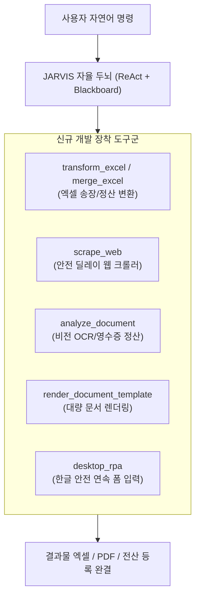

# 🚀 외주 기반 5대 핵심 자동화 시나리오 및 도구 구현 명세서

> **문서 버전**: v1.0.0  
> **기준 시장**: 크몽·숨고 업무 자동화 카테고리 고빈도 발주 데이터  
> **목적**: 실제 외주 의뢰 빈도가 가장 높은 5대 핵심 업무를 자비스(JARVIS)가 자율 수행할 수 있도록 사용자 요청을 구체화하고, 이에 필요한 전용 도구(Tools) 및 실행 파이프라인 명세를 정의함.  

---

## 📌 1. 개요 및 추진 배경

국내 프리랜서 외주 마켓플레이스(크몽, 숨고)의 실무 데이터 분석 결과, 발주량이 집중되는 영역은 화려한 이론적 AI 모델링이 아닌 **"반복적인 수작업 데이터 입력/추출/변환 병목을 1초 만에 해소하는 실무 파이프라인"**에 집중되어 있습니다.

본 문서는 이러한 시장 수요를 완벽히 해결하기 위한 **5대 킬러 시나리오**를 정의하고, 각 시나리오를 해결하기 위해 JARVIS 두뇌에 장착할 **신규 도구(Tools)**와 **엔드투엔드 파이프라인**을 규격화합니다.

---

## 📋 2. 5대 핵심 자동화 시나리오 상세 명세

---

### 📦 시나리오 1. 다채널 주문서 취합 및 택배사 송장 양식 자동 변환 (이커머스/물류)
* **시장 수요**: 외주 의뢰 비중 **30%** (단일 서비스 최다 발주 분야)
* **해결 과제**: 쿠팡, 스마트스토어, 11번가 등 플랫폼마다 제각각인 엑셀 컬럼과 중복 수령인을 택배사(CJ대한통운, 우체국, 롯데) 규격 양식으로 1초 변환.

#### 1) 사용자 실제 자연어 지시문 (User Prompt)
> *"orders 폴더에 있는 쿠팡, 스마트스토어, 지마켓 주문 엑셀 파일들을 읽어서, 서로 다른 컬럼명을 통일하고 동일 수령인의 중복 주문을 합친 다음 `outputs/CJ대한통운_송장양식.xlsx`로 일괄 변환해줘."*

#### 2) 입출력 데이터 명세
* **입력 (Inputs)**: 
  - `orders/쿠팡_20260913.xlsx` (헤더: `묶음배송번호`, `받는사람`, `수하인전화번호`, `구매수량` 등)
  - `orders/스마트스토어_20260913.xlsx` (헤더: `상품주문번호`, `수취인명`, `연락처1`, `수량` 등)
* **출력 (Outputs)**: 
  - `outputs/CJ대한통운_송장양식.xlsx` (규격 헤더: `받는분성명`, `전화번호`, `배송지주소`, `품목명`, `수량`, `배송메시지`)

#### 3) 신규 개발 및 장착 도구
| 도구명 | 파라미터 (Schema) | 설명 |
|:---|:---|:---|
| `transform_excel` | `source_path: str, mapping_rules: dict, output_path: str` | 이기종 엑셀 컬럼을 타깃 스키마로 자동 매핑 및 포맷 변환 |
| `merge_excel_sheets` | `file_paths: list, dedupe_keys: list` | 복수의 엑셀 파일을 기준 키(수령인+연락처) 기준으로 합산·병합 |

#### 4) 엔드투엔드 실행 파이프라인
1. `scan_directory`: `orders/` 폴더 내 주문 엑셀 파일 목록 인덱싱.
2. `read_file`: 각 파일의 헤더 구조 자동 인식.
3. `transform_excel`: 플랫폼별 헤더를 택배사 표준 규격으로 매핑 변환.
4. `merge_excel_sheets`: 동일 고객 주문 건 수량 합산 및 중복 제거.
5. `create_excel`: 비즈니스 서식(테두리, 너비 자동 조정) 적용 후 최종 산출물 생성.

---

### 🌐 시나리오 2. 웹 상품 가격·리뷰 경쟁사 데이터 수집 및 모니터링 (크롤링/마케팅)
* **시장 수요**: 외주 의뢰 비중 **30%**
* **해결 과제**: 매일 아침 눈으로 포털을 확인하던 수작업을 자동화하여 실시간 최저가, 품절 여부, 리뷰 추이 적재.

#### 1) 사용자 실제 자연어 지시문 (User Prompt)
> *"네이버 쇼핑에서 '캠핑의자'로 검색해서 1페이지부터 3페이지까지의 상품명, 실시간 판매가, 스토어명, 리뷰 수, 평점을 스크랩한 뒤 `outputs/캠핑의자_경쟁사가격.xlsx`에 저장해줘."*

#### 2) 입출력 데이터 명세
* **입력 (Inputs)**: 검색 키워드, 타깃 URL 패턴, 수집 페이지 수(1~3), 추출 희망 필드 목록
* **출력 (Outputs)**: `outputs/캠핑의자_경쟁사가격.xlsx` (실시간 수집 상품 테이블)

#### 3) 신규 개발 및 장착 도구
| 도구명 | 파라미터 (Schema) | 설명 |
|:---|:---|:---|
| `scrape_web` | `url: str, selectors: dict, max_items: int = 50, random_delay: bool = True` | Playwright 기반 비동기 DOM 추출기 |

> [!IMPORTANT]
> **대법원 판례 준수 법적 안전장치 내장**
> * 요청 간 **1~3초의 무작위 대기 시간(Random Delay)** 강제 적용 (업무방해죄 원천 차단).
> * 로그인/CAPTCHA 우회 기능 배제, 오직 공개 웹페이지 사실 정보만 수집.

#### 4) 엔드투엔드 실행 파이프라인
1. `scrape_web`: 타깃 URL에 접근하여 렌더링된 DOM에서 지정 셀렉터 데이터 추출 (완충 딜레이 적용).
2. `format_data`: 추출된 텍스트에서 가격(숫자), 리뷰 수 정규식 파싱.
3. `create_excel`: 정제된 데이터를 천단위 콤마 서식이 적용된 엑셀로 자동 저장.

---

### 🧾 시나리오 3. 영수증·인보이스 시각 자동 분석 및 지출결의서 집계 (회계/세무 OCR)
* **시장 수요**: 외주 의뢰 비중 **15%** (월말 정산 시즌 집중 의뢰)
* **해결 과제**: 스마트폰으로 촬영된 수십 장의 영수증 사진에서 금액과 부가세를 눈으로 읽고 타이핑하던 오류와 야근 퇴치.

#### 1) 사용자 실제 자연어 지시문 (User Prompt)
> *"receipts 폴더에 있는 영수증/카드전표 사진들을 전부 읽어서, 거래일자, 상호명, 사업자번호, 품목, 공급가액, 부가세를 추출하고 `outputs/9월_지출결의서.xlsx`로 일괄 합산 정리해줘."*

#### 2) 입출력 데이터 명세
* **입력 (Inputs)**: `receipts/` 폴더 내 영수증 이미지들 (`receipt_01.jpg`, `receipt_02.png` 등)
* **출력 (Outputs)**: `outputs/9월_지출결의서.xlsx` (거래 건별 행 + 하단 `SUM` 합계 행 포함)

#### 3) 신규 개발 및 장착 도구
| 도구명 | 파라미터 (Schema) | 설명 |
|:---|:---|:---|
| `analyze_document` | `file_path: str, doc_type: str = "receipt"` | Gemini 2.5 Flash / Ollava Llava 기반 정형 키값(JSON) 추출기 |

#### 4) 엔드투엔드 실행 파이프라인
1. `scan_directory`: `receipts/` 폴더 내 이미지 파일 탐색.
2. `analyze_document` (배치 실행): 영수증 이미지별 거래일자, 상호, 공급가액, 부가세 JSON 파싱.
3. `validate_math`: `공급가액 + 부가세 == 합계금액` 일치 여부 수학적 자가 검증.
4. `create_excel`: 지출결의서 표준 서식으로 엑셀 렌더링.

---

### 📄 시나리오 4. 엑셀 명단 기반 계약서·위촉장 대량 렌더링 및 PDF 일괄 변환 (행정/문서 RPA)
* **시장 수요**: 외주 의뢰 비중 **10%** (공공기관, 협회, 학술단체)
* **해결 과제**: 수백 명의 인적 사항을 한글/워드 서식에 한 땀 한 땀 복사/붙여넣기 하던 비효율 해소.

#### 1) 사용자 실제 자연어 지시문 (User Prompt)
> *"members.xlsx 명단에 있는 이름, 소속, 직책, 생년월일을 읽어서 `template_위촉장.docx` 양식의 플레이스홀더에 각각 치환해 넣고, `outputs/certificates/` 폴더에 개인별 PDF 파일로 대량 일괄 생성해줘."*

#### 2) 입출력 데이터 명세
* **입력 (Inputs)**: 
  - `members.xlsx` (수백 명의 인적 사항 명단)
  - `template_위촉장.docx` (플레이스홀더: `{{성명}}`, `{{소속}}`, `{{직책}}`)
* **출력 (Outputs)**: `outputs/certificates/위촉장_홍길동.pdf` 등 인원수만큼의 개별 PDF 파일들

#### 3) 신규 개발 및 장착 도구
| 도구명 | 파라미터 (Schema) | 설명 |
|:---|:---|:---|
| `render_document_template` | `template_path: str, data_row: dict, output_path: str` | DOCX/HWPX 내 템플릿 변수 고속 치환기 |
| `convert_to_pdf` | `source_path: str, output_path: str` | 오피스 문서를 무인 백그라운드 PDF로 변환하는 도구 |

#### 4) 엔드투엔드 실행 파이프라인
1. `read_file`: `members.xlsx` 명단 데이터 로드.
2. `render_document_template` (반복): 각 행의 데이터를 템플릿에 주입하여 임시 문서 생성.
3. `convert_to_pdf`: 임시 문서를 개별 PDF로 일괄 컴파일.
4. `scan_directory`: 생성된 파일 수와 명단 수 1:1 일치 여부 검증 후 완료 보고.

---

### 🖱️ 시나리오 5. 엑셀 데이터 기반 사내 ERP 및 웹 폼 연속 자동 입력 (데스크톱 GUI RPA)
* **시장 수요**: 외주 의뢰 비중 **15%**
* **해결 과제**: 오픈마켓 어드민이나 폐쇄적인 사내 ERP 전산망에 수백 건의 상품/회원 정보를 단순 반복 타이핑 등록하는 노동 집약 작업 해소.

#### 1) 사용자 실제 자연어 지시문 (User Prompt)
> *"products.xlsx에 있는 신상품 50개 목록을 읽어서, 화면에 열려 있는 쇼핑몰 관리자 페이지의 상품명, 판매가, 재고수량 입력 필드에 Tab 키로 이동하며 순서대로 자동 타이핑하고 저장 버튼을 눌러줘."*

#### 2) 입출력 데이터 명세
* **입력 (Inputs)**: 등록할 상품 목록 엑셀 (`products.xlsx`) + 활성화된 대상 프로그램 윈도우
* **출력 (Outputs)**: 전산 등록 완료 로그 및 성공/실패 건수 집계 리포트

#### 3) 신규 개발 및 장착 도구
| 도구명 | 파라미터 (Schema) | 설명 |
|:---|:---|:---|
| `desktop_type_text` | `text: str` | 한글 IME 조합 깨짐 방지 클립보드 기반 자동 타이핑 |
| `desktop_press_hotkey` | `keys: list[str]` | `Tab`, `Enter`, `Ctrl+S` 등 연속 폼 이동 단축키 실행 |
| `desktop_click` | `x: int, y: int` | 특정 좌표 또는 버튼 클릭 |

> [!CAUTION]
> **안전 가드레일 (Fail-Safe)**
> * 마우스 화면 모서리 강제 이동 시 즉시 매크로 정지 (`pyautogui.FAILSAFE = True`).
> * 글로벌 단축키 `Ctrl + Alt + S` 입력 시 백그라운드 작업 즉각 강제 종료 (Kill-switch).

#### 4) 엔드투엔드 실행 파이프라인
1. `read_file`: `products.xlsx`에서 등록할 데이터 행 로드.
2. 대상 창 포커스 활성화 확인.
3. 루프 실행: `desktop_type_text` (입력) ➔ `desktop_press_hotkey(["tab"])` (다음 필드 이동) ➔ `desktop_click` (저장).
4. 결과 로그 작성 및 완결 보고.

---

## 🛠️ 3. 신규 도구 개발 로드맵 및 우선순위

기존에 구축된 **기본 OS 도구(scan_directory, read/write_file, create_excel, capture_screen)**와의 연계 효율성을 극대화하기 위해 다음과 같은 순서로 도구를 고도화합니다:

| 단계 | 개발할 도구명 | 대상 시나리오 | 연계되는 기존 도구 | 기대 효과 |
|:---:|:---|:---:|:---|:---|
| **Phase 1** | `analyze_document` | **시나리오 3 (영수증 정산)** | `capture_screen` + `create_excel` | **시각인식 ➔ 엑셀 변환 원스톱 완성 (최우선 추천)** |
| **Phase 2** | `transform_excel`, `merge_excel` | **시나리오 1 (송장/주문 변환)** | `read_file` + `create_excel` | 외주 발주량 1위 영역 정복 |
| **Phase 3** | `scrape_web` | **시나리오 2 (가격 모니터링)** | `create_excel` | 웹 데이터 수집 자동화 완성 |
| **Phase 4** | `desktop_type_text`, `desktop_hotkey` | **시나리오 5 (GUI 폼 RPA)** | `read_file` + Safety Guard | 반복 클릭/타이핑 완전 자동화 |
| **Phase 5** | `render_document_template` | **시나리오 4 (문서 렌더링)** | `read_file` + `scan_directory` | 대량 계약서/증명서 PDF 발행 |

---

## 🧪 4. 검증 및 품질 관리 기준
* **TDD 엄수**: 각 도구 개발 시 `tests/unit/test_tools_*.py` 단위 테스트를 먼저 작성(Red)하고 구현(Green) 진행.
* **Shadow Workspace 격리**: 파일 생성/변환 도구는 `.jarvis/staging/`에서 생성 후 UniversalRuleEvaluator 검증 통과 시 워크스페이스에 최종 커밋.
* **로그 추적 1:1 보장**: 신규 도구 실행 시에도 5대 세션 로그 규격(도구명, 정밀 실행 시간, 호출 인자 원문, 관측 결과)이 그대로 기록되도록 보장.
